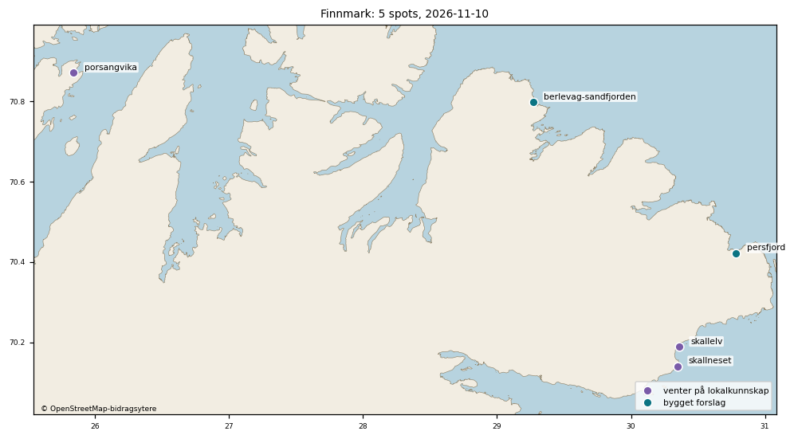
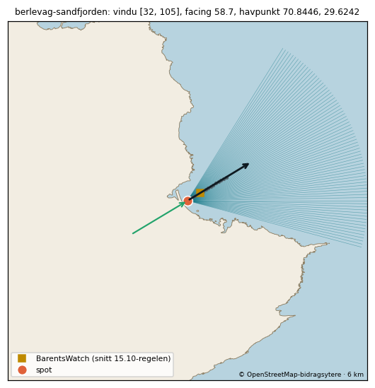
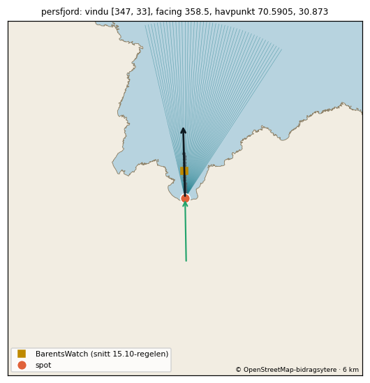

# Gjennomgangspakke: Finnmark (5 spots)

Laget 2026-11-10 av tools/region_pakke.py fra spots.json (gjelder der spoten ligger inne) og fabrikkens forslag (data/kandidater/bygget/<id>.json). 2 bygget forslag, 3 venter på lokalkunnskap.

Vindu: fri linje 150 km over GSHHS f (300 m kysttoleranse). Facing: strandnormal ±150 m langs kysten. Offshore-vind: motsatt av facing ±45° når ikke annet står. BarentsWatch-punkt: snittregelen 15.10 (første punkt utover med minst 8 m dyp og flat Hs). Tidevann: Kartverkets referansested for posisjonen. Vern: Naturbase innen 2 km, målt fra spotens posisjon der oppslaget finnes (ellers fra listepinnen, og da står det), forskriften lest på Lovdata. Sikkerhet: A = navn, strandtype, synlig bølge/formasjon og retning stemmer; B = to av fire; C = resten (bygges ikke).

## Posisjonsrunden og gjennomgangen 10.11.2026

Hele svaret fra spotansvarlig ligger i `finnmark-gjennomgang.csv` (én linje per spot): **2 godkjent, 3 avvis.** Ingenting i spots.json eller appen er endret. Finnmark har ingen spots i appen fra før.

- **Godkjent (2):** berlevag-sandfjorden og persfjord. Begge har posisjon med sikkerhet A og er bygget med spotfabrikken uten rettelser.
- **Avvis (3):** porsangvika, skallelv og skallneset venter på lokalkunnskap og er ikke bygget.

## BarentsWatch-snittet

Snittet ble hentet 10.11 kl. 11:35Z (0 til 3 km langs facing, 18 tidspunkter, hver 3. time fra 10.11 kl. 06Z til 12.11 kl. 09Z, `data/bw_point_search/result_2026-11-10T1135_kandidater.json`).

| Spot | Punkt | Hs ved punktet (median) | Retning ved punktet | Regelen fant punktet i |
|---|---|---|---|---|
| berlevag-sandfjorden | 500 m ut, 8,0 m | 0,86 m | 5° (31° i valgt time) | 12 av 18 tidspunkter (2 av 5 med svell i vinduet) |
| persfjord | 900 m ut, 8,8 m | 1,13 m | 350° | 9 av 18 tidspunkter (8 av 13 med svell i vinduet) |

- **berlevag-sandfjorden, nordkanten av vinduet har lavere sikkerhet.** Svellet ute kom mest fra 5–34° i snittet. Nordlig svell (5–12°, utenfor vinduet 32–105°) nådde likevel punktet med 0,7–1,2 m. OSM-kysten gir vindu 13–107°. Vinduet er ikke rettet, for det finnes ingen observasjoner. 10 av de 12 tidspunktene regelen fant punktet i, hadde svell ute fra 349–12°, altså utenfor vinduet. I de to med svell i vinduet var perioden ved punktet 3,6–4,5 s, altså vindsjø. Appen vil trolig vise «Treffer ikke» når svellet kommer rett fra nord.
- **berlevag-sandfjorden:** EMODnet gir land på selve posisjonen og 100 m ut (−2,3 m og −0,3 m). Det skyldes det grove rutenettet.
- **persfjord:** EMODnet gir −4,3 m på selve posisjonen. Posisjonen ligger 91 m fra OSM-kysten, så det skyldes det grove rutenettet. Første punkt med 8 m ligger 900 m ut.
- Høydene [0,8, 2,0] og maks 3,5 er fabrikkens standard for strand, ukalibrert. Offshore-vinden er standard (motsatt av facing ±45°), ubekreftet. Tidevannet følger Vardø.

## Vern

- **berlevag-sandfjorden** ligger inne i Sandfjorden landskapsvernområde. Forskriften begrenser bare motorisert ferdsel.
- **persfjord** ligger 375 m utenfor Persfjorden-Syltefjorden landskapsvernområde. Der kreves bare varsom ferdsel.

## Hva som skal til

| Spot | Hva som mangler | Hvem |
|---|---|---|
| berlevag-sandfjorden, persfjord | Theodors ja til regionen. Da settes spotene inn i spots.json (`tools/godkjenn_spot.py`), og det kjøres én prøvehenting før merge. | Theodor |
| porsangvika | Posisjonen er god, men vinduet mot åpent hav er bare 5° (GSHHS) til 10° (OSM). Noen må vite om dønningen når inn. | Lokalkunnskap |
| skallelv | Usikkert hvilken strand det surfes på. Osen og stranda nord for odden gir helt ulike spots, og GSHHS legger osen på land. | Lokalkunnskap |
| skallneset | Revet er ikke funnet på flyfoto, og GSHHS legger posisjonen på land. | Lokalkunnskap |

## Ikke sjekket

- Flyfotoene er ikke sett på nytt etter posisjonsrunden. Gjennomgangen bygger på minikart, OSM-kyst og snittet.
- EMODnet og BarentsWatch bruker ikke samme bunn, så 8 m-kravet er testet mot en annen bunn enn Hs-profilen.
- Snittet dekker to døgn med svell mest fra nord til nordøst (349–38° ute). Østlig svell er ikke sett.

## Oversikt

| id | Navn | Region | Status | Sikkerhet | facing | Vindu | Offshore-vind | BarentsWatch-punkt |
|---|---|---|---|---|---|---|---|---|
| berlevag-sandfjorden | Berlevåg Sandfjorden | Finnmark | bygget forslag | A | 58.7° | 32–105° | 194–284° | 70.800563, 29.280105 (500 m ut i retning 59°, 8.0 m dyp) |
| persfjord | Persfjord | Finnmark | bygget forslag | A | 358.5° | 347–33° | 134–224° | 70.429457, 30.783921 (905 m ut i retning 359°, 8.8 m dyp) |
| porsangvika | Porsangvika | Finnmark | venter på lokalkunnskap | A (forslag, ikke godkjent) | – | – | – | – |
| skallelv | Skallelv | Finnmark | venter på lokalkunnskap | B (forslag, ikke godkjent) | – | – | – | – |
| skallneset | Skallneset | Finnmark | venter på lokalkunnskap | B (forslag, ikke godkjent) | – | – | – | – |

## Holdes tilbake, parkert eller ikke bygget

| id | Status | Hvorfor |
|---|---|---|
| porsangvika | venter på lokalkunnskap | Posisjonen er god: én buet sandstrand mot ØNØ, 60 m utenfor vannkanten ved fjære (230 m fra OSM-kysten). Men vinduet mot åpent hav er bare 5° i GSHHS (61-65°) og 10° med OSM ved 150 km, fordi vika ligger inne i munningen av Porsangerfjorden og østlig dønning (hintet) stenges av land på andre siden; ved listepinnen 330 m lenger ut er det 15°. Bygges ikke før noen kan si om dønningen faktisk når inn (trolig wrap, som vi ikke har modell for). |
| skallelv | venter på lokalkunnskap | Flyttet 975 m fra listepinnen til elveosen, men flyfotorunden er selv usikker på hvilken strand det surfes på, og osen (kystnormal ca. 198°) og alternativet nord for odden (ca. 106°) ville gitt helt ulike spots. Vinduet mot Barentshavet er ca. 41° med OSM, men bare 11° i GSHHS fordi GSHHS legger osen på land, så fabrikken vil regne feil her. Trenger lokalkunnskap om stranda før bygging. |
| skallneset | venter på lokalkunnskap | Rev med svak dokumentasjon (wannasurf og geonames). Listepinnen sto 234 m inne på land, og flyfotoet fant ikke selve revet, bare små bølgelinjer langs steinstranda. Hintet om dønning fra N kan ikke stemme fordi neset ligger på nordsida av Varangerfjorden, og GSHHS legger posisjonen på land (fabrikken får ikke noe vindu; OSM gir 60-107°); venter på noen som vet hvor revet er. |

## Kallbudsjett

| | Spots | Open-Meteo vektet per kjøring | per døgn (grense 10 000) | verste time (5 000) | verste minutt (600) | BarentsWatch per kjøring / døgn | met.no per kjøring | Kartverket per kjøring |
|---|---|---|---|---|---|---|---|---|
| i dag (publiserte) | 22 | 78 | 622 (6%) | 78 (2%) | 78 (13%) | 39 / 312 | 66 | 22 |
| med alle 2 ventende i regionen slått på | 24 | 85 | 677 (7%) | 85 (2%) | 85 (14%) | 41 / 328 | 72 | 24 |

Open-Meteo: vekt 1,14 per punkt (16 dager), to bølgemodeller per havpunkt og ett vindpunkt per spot, 8 kjøringer per døgn; verste minutt regner alle kall i en kjøring i samme minutt. Testen fetcher/test_kallregnskap.py holder hver grense under 50 %.

## Spotene

### Berlevåg Sandfjorden (`berlevag-sandfjorden`) - bygget forslag

| | |
|---|---|
| Posisjon | 70.798214, 29.268436 - godkjent forslag (flyfoto), spotansvarlig (agent, Theodor 10.11.2026), 2026-11-10. 60 m fra listepinnen. Ca. 1 km sandstrand som vender NØ, med elveos i nordvestenden. Listepinnen sto i vannkanten midt på stranda; flyttet ca. 60 m rett ut til sandbankene der det bryter hvitt. Hovedtoppen er ukjent. Posisjonen ligger fortsatt inne i Sandfjorden landskapsvernområde (121 m fra grensa). |
| Facing | 58.7° |
| Svellvindu | 32–105° |
| Offshore-vind | 194–284° |
| Havpunkt | 70.8446, 29.6242 (14 km ut i retning 68°) |
| BarentsWatch-punkt | 70.800563, 29.280105 (500 m ut i retning 59°, 8.0 m dyp) Snitt langs facing (data/bw_point_search/result_2026-11-10T1135_kandidater.json), regelen fra 15.10: snitt 500m@58.7, 500 m ut, dybde 8,0 m, Hs 1,12 m kl. 2026-11-10T15:00Z. |
| Eksponering | vindu 73° bredt, facing 10° fra midten; ingen geometrisk grunnlinje ennå - henteren bruker vindu og skyggekurve som reserve |
| Tidevannssted | Vardø (-39 min), faktor 0.88 |
| Høyder | ideal [0.8, 2.0], maks 3.5 |
| Vern/forbud | Sandfjorden landskapsvernområde, spoten ligger inne i området: bare motorisert ferdsel |
| Sikkerhet | A |
| Usikkert | offshore-vind: standard, ubekreftet (motsatt av facing ±45°) |

### Persfjord (`persfjord`) - bygget forslag

| | |
|---|---|
| Posisjon | 70.42132, 30.784553 - godkjent forslag (flyfoto), spotansvarlig (agent, Theodor 10.11.2026), 2026-11-10. 63 m fra listepinnen. Buet sandstrand innerst i fjorden som vender N, med elveos i østenden og et skjær ca. 150-200 m vest for pinnen. Listepinnen sto ca. 45 m fra vannkanten; flyttet til ca. 100 m ut midt på stranda øst for skjæret. Hovedtoppen er ukjent. Fortsatt utenfor Persfjorden-Syltefjorden landskapsvernområde (375 m). |
| Facing | 358.5° |
| Svellvindu | 347–33° |
| Offshore-vind | 134–224° |
| Havpunkt | 70.5905, 30.873 (19 km ut i retning 10°) |
| BarentsWatch-punkt | 70.429457, 30.783921 (905 m ut i retning 359°, 8.8 m dyp) Snitt langs facing (data/bw_point_search/result_2026-11-10T1135_kandidater.json), regelen fra 15.10: snitt 900m@358.5, 900 m ut, dybde 8,8 m, Hs 1,38 m kl. 2026-11-11T21:00Z. |
| Eksponering | vindu 46° bredt, facing 12° fra midten; ingen geometrisk grunnlinje ennå - henteren bruker vindu og skyggekurve som reserve |
| Tidevannssted | Vardø (-5 min), faktor 0.99 |
| Høyder | ideal [0.8, 2.0], maks 3.5 |
| Vern/forbud | Persfjorden-Syltefjorden landskapsvernområde/ Biezavuona-Oardduvuona suodjemeahcci, 375 m fra spoten (listepinnen: 346 m): bare krav om varsom ferdsel |
| Sikkerhet | A |
| Usikkert | offshore-vind: standard, ubekreftet (motsatt av facing ±45°) |

### Porsangvika (`porsangvika`) - venter på lokalkunnskap

| | |
|---|---|
| Posisjon | 70.8714, 25.8403 - listepinnen (ikke kontrollert) |
| Forslag | 70.871411, 25.833244 (claude-flyfoto-2026-11-10, sikkerhet A, ikke godkjent; flyttet 257 m fra listepinnen). Én buet sandstrand innerst i vika som vender ØNØ, slik hintet om dønning fra øst tilsier. Flyfotoet er tatt på fjære sjø med 150-200 m bred sandflate. Listepinnen sto ca. 330 m utenfor lavvannslinja; flyttet inn til ca. 60 m utenfor den synlige vannkanten midt på stranda. Hovedtoppen er ukjent, og avstanden til stranda varierer mye med tidevannet. |
| Sikkerhet | A (forslag, ikke godkjent) |
| Vern/forbud | ingen verneområder innen 2 km av forslaget |
| Usikkert | Posisjonen er god: én buet sandstrand mot ØNØ, 60 m utenfor vannkanten ved fjære (230 m fra OSM-kysten). Men vinduet mot åpent hav er bare 5° i GSHHS (61-65°) og 10° med OSM ved 150 km, fordi vika ligger inne i munningen av Porsangerfjorden og østlig dønning (hintet) stenges av land på andre siden; ved listepinnen 330 m lenger ut er det 15°. Bygges ikke før noen kan si om dønningen faktisk når inn (trolig wrap, som vi ikke har modell for). |

### Skallelv (`skallelv`) - venter på lokalkunnskap

| | |
|---|---|
| Posisjon | 70.1882, 30.361 - listepinnen (ikke kontrollert) |
| Forslag | 70.183332, 30.339498 (claude-flyfoto-2026-11-10, sikkerhet B, ikke godkjent; flyttet 975 m fra listepinnen). Listepinnen sto ved en steinodde mellom strendene. Hintet sier strand og elveos med dønning fra SSØ, så posisjonen er satt på sandbanken ca. 110 m utenfor munningen av Skallelva, der en sandtange møter et steinete nes. Sandstranda fortsetter sørover fra osen. Stor flytting, og det er usikkert hvilken av strendene det surfes på. Trenger lokalkunnskap. |
| Sikkerhet | B (forslag, ikke godkjent) |
| Vern/forbud | ingen verneområder innen 2 km av forslaget |
| Usikkert | Flyttet 975 m fra listepinnen til elveosen, men flyfotorunden er selv usikker på hvilken strand det surfes på, og osen (kystnormal ca. 198°) og alternativet nord for odden (ca. 106°) ville gitt helt ulike spots. Vinduet mot Barentshavet er ca. 41° med OSM, men bare 11° i GSHHS fordi GSHHS legger osen på land, så fabrikken vil regne feil her. Trenger lokalkunnskap om stranda før bygging. |

### Skallneset (`skallneset`) - venter på lokalkunnskap

| | |
|---|---|
| Posisjon | 70.1397, 30.349 - listepinnen (ikke kontrollert) |
| Forslag | 70.140401, 30.363523 (claude-flyfoto-2026-11-10, sikkerhet B, ikke godkjent; flyttet 554 m fra listepinnen). Listepinnen sto på land midt på neset, 234 m fra sjøen. Neset har flate bergheller; på den nordøstvendte sida like nord for østspissen går små hvite bølgelinjer langs steinstranda. Satt ca. 50 m utenfor denne sida ved spissen. Dokumentasjonen er svak, og akkurat hvilket rev det gjelder er usikkert. |
| Sikkerhet | B (forslag, ikke godkjent) |
| Vern/forbud | ingen verneområder innen 2 km av forslaget |
| Usikkert | Rev med svak dokumentasjon (wannasurf og geonames). Listepinnen sto 234 m inne på land, og flyfotoet fant ikke selve revet, bare små bølgelinjer langs steinstranda. Hintet om dønning fra N kan ikke stemme fordi neset ligger på nordsida av Varangerfjorden, og GSHHS legger posisjonen på land (fabrikken får ikke noe vindu; OSM gir 60-107°); venter på noen som vet hvor revet er. |

Kyst © OpenStreetMap-bidragsytere og GSHHS; dybde EMODnet Bathymetry; tidevann © Kartverket; bølger BarentsWatch; vern Naturbase (Miljødirektoratet).
