# Gjennomgangspakke: Lofoten, Vesterålen (27 spots)

Laget 2026-11-10 av tools/region_pakke.py fra spots.json (gjelder der spoten ligger inne) og fabrikkens forslag (data/kandidater/bygget/<id>.json). 15 publisert, 5 holdt tilbake, 3 parkert, 4 venter på lokalkunnskap.

Vindu: fri linje 150 km over GSHHS f (300 m kysttoleranse). Facing: strandnormal ±150 m langs kysten. Offshore-vind: motsatt av facing ±45° når ikke annet står. BarentsWatch-punkt: snittregelen 15.10 (første punkt utover med minst 8 m dyp og flat Hs). Tidevann: Kartverkets referansested for posisjonen. Vern: Naturbase innen 2 km, målt fra spotens posisjon der oppslaget finnes (ellers fra listepinnen, og da står det), forskriften lest på Lovdata. Sikkerhet: A = navn, strandtype, synlig bølge/formasjon og retning stemmer; B = to av fire; C = resten (bygges ikke).

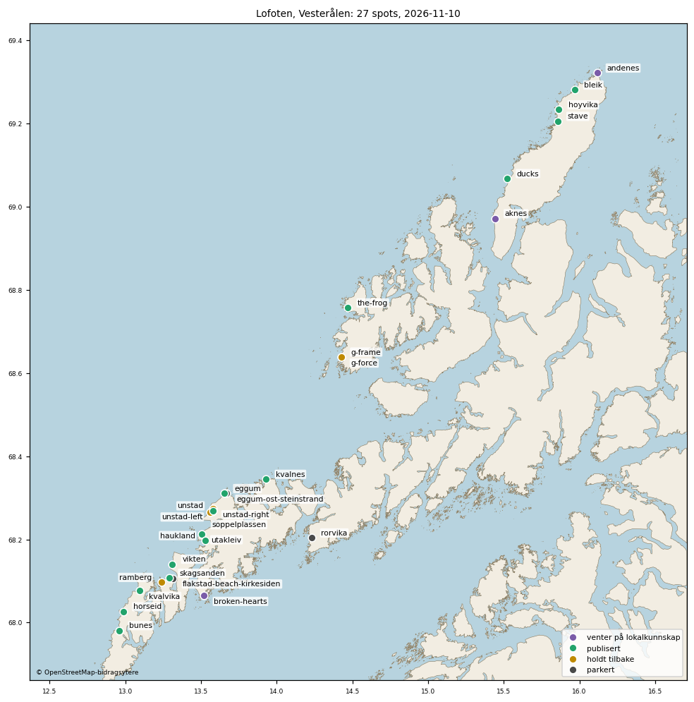

## Nytt siden gjennomgangen 16.10.2026

- **#22 er merget til main (10.11.2026).** Claudes gjennomgang 16.10 ga 14 godkjent og 6 rettet (20 nye spots), og flakstad-beach-kirkesiden og rorvika parkert. eggum-ost-steinstrand ble parkert samme dag, så 19 nye ligger i spots.json. 14 av dem er publisert, og 5 holdes tilbake. Med Unstad, som lå der fra før, er 15 spots i regionene live.
- **Pakka er laget på nytt fra spots.json.** Den forrige utgaven av tabellen (16.10) viste verdiene fra før rettelsene (unstad-left 285°, soppelplassen 300°). Gjeldende verdier står i tabellene under.
- **Rettet etter gjennomgangen 16.10:** unstad-left, unstad-right og soppelplassen har Unstads facing 294,8° (kontrollørens andre runde). horseid har facing 305°. g-frame har BarentsWatch-punktet flyttet fra 1 400 m til 1 900 m ut, fordi 1 400 m lå i et grunnfelt.
- **Holdt tilbake siden 16.10:** g-frame, unstad-left, unstad-right og soppelplassen (`enabled: false`).
- **Holdt tilbake 10.11:** ramberg, til T2b er avgjort (Theodors ja 10.11).
- **Parkert:** eggum-ost-steinstrand (eget snitt 16.10 fant ikke noe punkt), rorvika og flakstad-beach-kirkesiden.
- **Vern måles nå fra spotens posisjon**, ikke fra listepinnen, der Naturbase-oppslaget rundt posisjonen finnes. Bunes ligger inne i Lofotodden nasjonalpark (0 m, ikke 531 m som pakka sa før). Der er det varsom ferdsel og ikke noe forbud, så ingenting endres i appen.

## Spotansvarligs gjennomgang 10.11.2026

Hele svaret ligger i `lofoten-vesteralen-gjennomgang.csv` (én linje per spot): **17 godkjent, 3 rett, 7 avvis.** Kommentarene for eggum, eggum-ost-steinstrand og g-frame er presisert etter kontrollørens gjennomgang (retningen til reservatet, snitt i stedet for spenn, og bølgeretningen i snittet). Beslutningene er uendret.

- **Godkjent (17):** de 14 nye publiserte, Unstad, unstad-left og unstad-right. Facing ligger innenfor spennet OSM-kysten gir (±150 til ±500 m rundt spoten) for 13 av de 14 nye. Spennet er bredt for skagsanden (313-348°), haukland (210-235°) og kvalnes (337-348°). Unntaket er horseid, der 305° er satt med vilje (fabrikken gir 192-231°, langs stranda), så et nytt fabrikkbygg må ikke skrive over den.
- **Rett (3):** g-frame, ramberg og soppelplassen. Ingen av dem er live, og ingenting er endret i spots.json. Se tabellen under.
- **Avvis (7):** aknes, andenes, broken-hearts og g-force venter på lokalkunnskap. eggum-ost-steinstrand, rorvika og flakstad-beach-kirkesiden blir stående parkert.

Svar på spørsmålene til gjennomgangen:

1. **De 14 nye publiserte trenger ikke ny gjennomgang av geometrien.** To ting står åpne: grensa mot Eggum naturreservat (se under), og at varselet gir Unstad mindre enn naboene (ROADMAP N og T2b).
2. **unstad-right beholder punktet foreløpig.** Bølgene ved punktet kom fra 288-310° (0-15° fra facing), og Hs er flat fra 400 m og utover. Punktet er likevel ikke valgt etter regelen (700 m ut i retning 239°, 8,6 m i en lomme mellom punkter på 7,2 og 7,3 m). Nytt snitt langs 294,8° tas når N er avgjort.
3. **Ikke ett felles punkt for de tre i Unstad-bukta.** unstad-left kan dele punkt med Unstad (samme bukt, nesten samme vindu). soppelplassen er åpnere mot nord og beholder sitt. unstad-right får eget snitt. Samme punktregel bør gjelde alle. Spotansvarlig foreslår at Unstads `surf_factor_prior` fjernes i samme commit som N, ellers flyttes bare ulikheten. Det er kalibrering, så Theodor avgjør det i T2.
4. **eggum-ost-steinstrand blir stående parkert.** Se tabellen under.

## Hva som skal til for spotene som ikke er publisert

| Spot | Hva som mangler | Hvem |
|---|---|---|
| g-frame | Bølgene kom fra vest i snittet 16.10 (100 m til 3 km): medianen er 254-284° i alle snittpunktene utenom grunnfeltet ved 1 700-1 800 m, og 87 % av timene ligger innenfor 246-288°. Facing 330° følger kysten nordover. Spotansvarlig anbefaler facing ca. 270°, offshore 45-135° og nytt snitt langs 270°. BarentsWatch-punktet 1 900 m ut (9,9 m) ligger utenfor fabrikkens 1,5 km og har lavere sikkerhet. Teksten `_barentswatch` i spots.json nevner både det gjeldende punktet og det gamle (1 400 m, 6,0 m). Den ryddes sammen med facing. | Theodor (spørsmål i til-theodor.md) |
| unstad-left, unstad-right, soppelplassen | Ga 3,4-4,2 m når Unstad ga 1,6-1,8 m samme time i prøvevarselet 16.10 kl. 11Z (unstad-left ligger 250 m fra Unstad, unstad-right 485 m og soppelplassen 996 m). Unstads BarentsWatch-punkt (250 m ut) ligger trolig i brytesonen (ROADMAP N). Snittene deres ble tatt langs fabrikkens første facing (334° / 239° / 344°), ikke langs 294,8°. Når N er avgjort i T2: nye snitt langs 294,8° for unstad-left og unstad-right, og så ett samlet spørsmål til Theodor. | Theodor, etter T2 |
| soppelplassen (i tillegg) | Offshore-vinden er utvidet til 70-209° uten observasjon eller navngitt kilde. Spotansvarlig anbefaler 70-160°. Høydene [1,5, 3,5] mangler begrunnelse. Det samme gjelder høydene for g-frame, unstad-left og unstad-right («forslag fra Claude 16.10, ukalibrert»). Tas i det samlede spørsmålet etter N. | Theodor, etter T2 |
| ramberg | Venter på T2b (Unstad mot Flakstad). Posisjonen og punktet (900 m ut, 9,6 m) er godkjent av spotansvarlig. Facing 287,7° er strandnormalen, men ligger 9° utenfor eget vindu (297-348°), og bølgene ved punktet kom fra 327-330°. Facing 315° og offshore 90-180° ligger på grenen region/ramberg-315 og flytter spoten fra 0 til 2 stjerner. | Theodor, etter T2b |
| eggum-ost-steinstrand | Aldri 8 m dybde innen 1,5 km langs facing 11,5° (hylle på 6-7 m og skjær 1,2-1,4 km ut). Reserven (minst 6 m) ville valgt 600 m ut (6,2 m). Der kom bølgene fra 267-300° i snittet 16.10, altså 71-104° fra facing, og bak skjærene faller Hs til 0,1-0,7 m. Bølgene går langs kysten, så et annet punkt hjelper ikke. Blir stående parkert. | Lokalkunnskap om hvor og når det brekker |
| rorvika | Vinduet er ca. 6° mot Vestfjorden. Trenger en vindbølgemodell for innaskjærs spots. | Senere |
| flakstad-beach-kirkesiden | Bare svell som bøyer rundt odden (wrap), ingen fri linje til havet. Trenger en modell for wrap. | Senere |
| aknes, andenes, broken-hearts, g-force | Flyfotoet viser ikke sikkert hvor det surfes (sikkerhet C). Trenger noen som kjenner stedet. g-force ligger 131 m fra g-frame, og det må avklares om det er samme bølge. broken-hearts vender mot Vestfjorden, så vindusbredden må sjekkes før bygging. | Lokalkunnskap |

## Eggum og naturreservatet (til T2)

Eggum er publisert uten forbud. Eggum naturreservat (surfebrett forbudt hele året) ligger sør til sørvest for spoten (sektoren 150-225°). Nærmeste grensepunkt er 277 m unna i retning 152°, og i retning 210° er det 450 m. Langs stranda mot vest (240° og videre) er det ikke reservat innen 2 km. Grensa er ikke sjekket mot hvor bølgen faktisk brekker. Spørsmål til Lofoten Surfsenter i T2: hvor brekker bølgen på Eggum? Ligger den sør eller sørvest for pinnen, inne i reservatet, settes «Forbud nå».

## Flakstad (trengs i T2b)

- **`ramberg`** er Flakstad-stranda i T2b (Theodor 09.11.2026). Den er egen spot på 68.097007, 13.238991 med **eget BarentsWatch-punkt** 68.099482, 13.218344, 900 m ut langs 288°, 9,6 m dypt (snitt 16.10). Den har eget havpunkt og eget vindu (297-348°). Den er slått av til T2b er avgjort.
- **`skagsanden`** ligger 2,4 km nordøst for ramberg, ved Flakstad kirke, og er publisert. Den har også eget BarentsWatch-punkt (68.110503, 13.283045, 500 m ut, 9,3 m dypt), 2,9 km fra rambergs punkt. I kandidatlista har skagsanden aliasene «Flakstad Beach» og «Flakstad (Surfnerd/Breakfinder)». ramberg har ingen Flakstad-alias.
- **`flakstad-beach-kirkesiden`** ligger 1,0 km øst for skagsanden og er parkert.
- Begge strendene ved Flakstad har altså egne målepunkter. ramberg er hovedsammenligningen, fordi Theodor har sagt at Ramberg er Flakstad-stranda. skagsanden vises som egen kolonne, og Theodor velger når han ser tabellen.
- **Innspill til T2b:** i varselet 10.11 kl. 06Z er skagsanden større enn Unstad i alle de 32 timene de første to døgnene der minst én av dem har bølger (Unstad viser 0 i 21 av dem; høyeste verdi 1,14 m mot 1,92 m). Over hele varselet er tallet 57 av 83 timer. Det er motsatt av det Lofoten Surfsenter sier. ramberg kan ikke sammenlignes ennå, fordi den er slått av og mangler i varselarkivet.

## Oversikt

| id | Navn | Region | Status | Sikkerhet | facing | Vindu | Offshore-vind | BarentsWatch-punkt |
|---|---|---|---|---|---|---|---|---|
| aknes | Åknes | Vesterålen | venter på lokalkunnskap | C (forslag, ikke godkjent) | – | – | – | – |
| andenes | Andenes | Vesterålen | venter på lokalkunnskap | C (forslag, ikke godkjent) | – | – | – | – |
| bleik | Bleik | Vesterålen | publisert | B | 299.5° | 237–24° | 74–164° | 69.284933, 15.948122 (900 m ut i retning 300°, 10.0 m dyp) |
| broken-hearts | Broken Hearts | Lofoten | venter på lokalkunnskap | C (forslag, ikke godkjent) | – | – | – | – |
| bunes | Bunes | Lofoten | publisert | A | 331.9° | 271–352° | 107–197° | 67.985151, 12.954839 (502 m ut i retning 332°, 9.2 m dyp) |
| ducks | Ducks | Vesterålen | publisert | B | 323.0° | 252–22° | 98–188° | 69.073055, 15.511701 (702 m ut i retning 323°, 17.6 m dyp) |
| eggum | Eggum | Lofoten | publisert | B | 330.7° | 234–31° | 106–196° | 68.319372, 13.64172 (1104 m ut i retning 331°, 13.0 m dyp) |
| eggum-ost-steinstrand | Eggum øst (steinstrand) | Lofoten | parkert | B | 11.5° | 283–31° | 146–236° | ikke funnet (se «Usikkert») |
| flakstad-beach-kirkesiden | Flakstad Beach (kirkesiden) | Lofoten | parkert | B | 50.2° | – | 185–275° | ikke funnet (se «Usikkert») |
| g-force | G-force | Vesterålen | venter på lokalkunnskap | C (forslag, ikke godkjent) | – | – | – | – |
| g-frame | G-frame | Vesterålen | holdt tilbake | B | 330.0° | 246–334° | 105–195° | 68.653782, 14.40406 (1907 m ut i retning 330°, 9.9 m dyp) |
| haukland | Haukland | Lofoten | publisert | B | 225.0° | 252–276° | 0–90° | 68.194957, 13.51855 (401 m ut i retning 225°, 8.0 m dyp) |
| horseid | Horseid | Lofoten | publisert | B | 305.0° | 308–4° | 80–170° | 68.028625, 12.978899 (400 m ut i retning 305°, 9.5 m dyp) |
| hoyvika | Høyvika | Vesterålen | publisert | B | 261.5° | 233–296° | 36–126° | 69.232612, 15.848527 (599 m ut i retning 261°, 8.8 m dyp) |
| kvalnes | Kvalnes | Lofoten | publisert | B | 346.2° | 269–23° | 121–211° | 68.347537, 13.928249 (302 m ut i retning 346°, 9.9 m dyp) |
| kvalvika | Kvalvika | Lofoten | publisert | A | 307.2° | 270–348° | 82–172° | 68.080482, 13.080912 (601 m ut i retning 307°, 12.0 m dyp) |
| ramberg | Ramberg | Lofoten | holdt tilbake | B | 287.7° | 297–348° | 63–153° | 68.099482, 13.218344 (900 m ut i retning 288°, 9.6 m dyp) |
| rorvika | Rørvika | Lofoten | parkert | B | 182.9° | 222–226° + 232–234° | 318–48° | ikke funnet (se «Usikkert») |
| skagsanden | Skagsanden | Lofoten | publisert | B | 319.2° | 280–4° | 94–184° | 68.110503, 13.283045 (501 m ut i retning 319°, 9.3 m dyp) |
| soppelplassen | Søppelplassen | Lofoten | holdt tilbake | B | 294.8° | 262–6° | 70–209° | 68.269442, 13.555641 (402 m ut i retning 344°, 10.1 m dyp) |
| stave | Stave | Vesterålen | publisert | B | 266.4° | 237–342° | 41–131° | 69.205143, 15.834028 (899 m ut i retning 266°, 8.1 m dyp) |
| the-frog | The Frog | Vesterålen | publisert | B | 250.0° | 220–275° | 25–115° | 68.756414, 14.465228 (200 m ut i retning 250°, 9.3 m dyp) |
| unstad | Unstad | Lofoten | publisert | – (lå i appen før kandidatlista) | 294.8° | 253–335° | 70–232° | 68.270164, 13.575278 (250 m ut i retning 295°, dybde ukjent) |
| unstad-left | Unstad Left | Lofoten | holdt tilbake | A | 294.8° | 257–344° | 70–232° | 68.273657, 13.568434 (703 m ut i retning 335°, 9.4 m dyp) |
| unstad-right | Unstad Right | Lofoten | holdt tilbake | A | 294.8° | 237–332° | 70–232° | 68.270129, 13.562945 (701 m ut i retning 239°, 8.6 m dyp) |
| utakleiv | Utakleiv | Lofoten | publisert | B | 292.4° | 245–6° | 67–157° | 68.214214, 13.496685 (300 m ut i retning 293°, 10.0 m dyp) |
| vikten | Vikten | Lofoten | publisert | B | 278.5° | 254–2° | 54–144° | 68.141023, 13.303437 (300 m ut i retning 279°, 9.5 m dyp) |

## Holdes tilbake, parkert eller ikke bygget

| id | Status | Hvorfor |
|---|---|---|
| aknes | venter på lokalkunnskap | Listepinnen sto på jordet. Satt utenfor den lille sandvika rett vest for pinnen (mye stein rundt). Usikkert hvilken strand som er surfespoten. |
| andenes | venter på lokalkunnskap | Listepinnen står på land i Andenes sentrum. Satt i vannet foran den lille sandvika på vestsiden, men det er mye skjær foran og usikkert om det er her det surfes. |
| broken-hearts | venter på lokalkunnskap | Listepinnen sto oppe på Ballstadøya (80 moh). Flyttet ned til ca. 80 m utenfor sørkysten av øya rett sør for pinnen, men flyfotoet viser ingen bølger, så selve revet/odden er ikke funnet. Må sjekkes av noen som kjenner stedet. |
| eggum-ost-steinstrand | parkert | Parkeres. Eggums BarentsWatch-punkt ligger 1 458 m unna med bølger fra 268-314° (57-103° fra facing 11,5°, retningsfaktor ca. 0). Eget snitt langs facing (16.10, result_2026-10-16T1118_kandidater.json) fant ikke noe punkt: grunn hylle 6-7 m dyp og skjær 1,2-1,4 km ut, aldri 8 m innen 1,5 km. Tas opp igjen med et lengre snitt eller et punkt utenfor skjærene (Theodor velger). |
| flakstad-beach-kirkesiden | parkert | Parkeres. Ligger i le bak halvøya og får bare dønning som brekker rundt odden (wrap). Fabrikken finner ingen fri linje til havet, så ratingen ville alltid vist «Treffer ikke». Tas opp igjen når vi har en modell for wrap. |
| g-force | venter på lokalkunnskap | Listepinnen (eksakt) er beholdt, men den ligger foran steinkanten sør for den lille sandstranda. Kan høre til foran stranda ca. 100 m nordøst. |
| g-frame | holdt tilbake | Holdt tilbake (Theodors ja 16.10, chat): retningen ved BarentsWatch-punktet 1 900 m ut (251-284° i prøvevarselet 16.10 11Z) ligger 46-79° fra facing 330 → retningsfaktor 0-0,6. Slås på når retningen ved punktet er avklart. |
| ramberg | holdt tilbake | Holdt tilbake (Theodors ja 10.11.2026): venter på T2b (Unstad mot Flakstad, Lofoten Surfsenter). Facing 315 og offshore [90,180] ligger på grenen region/ramberg-315 og flytter Ramberg fra 0 til 2 stjerner. Slås på når T2b er avgjort. |
| rorvika | parkert | Parkeres. Vinduet er bare ca. 6 grader (222-234) mot Vestfjorden, så den vil nesten alltid vise «Treffer ikke», og BarentsWatch fant intet punkt. Vurderes igjen når vi har vindbølgemodell for innaskjærs spots. |
| soppelplassen | holdt tilbake | Holdt tilbake (kontrollør 16.10, Claude delegert): i prøvevarselet 16.10 11Z gir spoten 3,4-4,2 m mens Unstad 250-600 m unna gir 1,6-1,8 m samme time (Unstads BarentsWatch-punkt ligger trolig i brytesonen - ROADMAP N). Slås på når Theodor har avgjort Unstads punkt/prior, eller med Theodors ja til å publisere med merknad. |
| unstad-left | holdt tilbake | Holdt tilbake (kontrollør 16.10, Claude delegert): i prøvevarselet 16.10 11Z gir spoten 3,4-4,2 m mens Unstad 250-600 m unna gir 1,6-1,8 m samme time (Unstads BarentsWatch-punkt ligger trolig i brytesonen - ROADMAP N). Slås på når Theodor har avgjort Unstads punkt/prior, eller med Theodors ja til å publisere med merknad. |
| unstad-right | holdt tilbake | Holdt tilbake (kontrollør 16.10, Claude delegert): i prøvevarselet 16.10 11Z gir spoten 3,4-4,2 m mens Unstad 250-600 m unna gir 1,6-1,8 m samme time (Unstads BarentsWatch-punkt ligger trolig i brytesonen - ROADMAP N). Slås på når Theodor har avgjort Unstads punkt/prior, eller med Theodors ja til å publisere med merknad. |

## Kallbudsjett

| | Spots | Open-Meteo vektet per kjøring | per døgn (grense 10 000) | verste time (5 000) | verste minutt (600) | BarentsWatch per kjøring / døgn | met.no per kjøring | Kartverket per kjøring |
|---|---|---|---|---|---|---|---|---|
| i dag (publiserte) | 22 | 78 | 622 (6%) | 78 (2%) | 78 (13%) | 39 / 312 | 66 | 22 |
| med alle 5 ventende i regionen slått på | 27 | 95 | 759 (8%) | 95 (2%) | 95 (16%) | 44 / 352 | 81 | 27 |

Open-Meteo: vekt 1,14 per punkt (16 dager), to bølgemodeller per havpunkt og ett vindpunkt per spot, 8 kjøringer per døgn; verste minutt regner alle kall i en kjøring i samme minutt. Testen fetcher/test_kallregnskap.py holder hver grense under 50 %.

## Spotene

### Åknes (`aknes`) - venter på lokalkunnskap

| | |
|---|---|
| Posisjon | 68.9715, 15.4423 - listepinnen (ikke kontrollert) |
| Forslag | 68.970876, 15.436888 (claude-flyfoto-2026-10-16, sikkerhet C, ikke godkjent; flyttet 227 m fra listepinnen). Listepinnen sto på jordet. Satt utenfor den lille sandvika rett vest for pinnen (mye stein rundt). Usikkert hvilken strand som er surfespoten. |
| Sikkerhet | C (forslag, ikke godkjent) |
| Vern/forbud | ingen verneområder innen 2 km av forslaget |
| Usikkert | Listepinnen sto på jordet. Satt utenfor den lille sandvika rett vest for pinnen (mye stein rundt). Usikkert hvilken strand som er surfespoten. |

### Andenes (`andenes`) - venter på lokalkunnskap

| | |
|---|---|
| Posisjon | 69.3218, 16.1165 - listepinnen (ikke kontrollert) |
| Forslag | 69.320837, 16.114091 (claude-flyfoto-2026-10-16, sikkerhet C, ikke godkjent; flyttet 143 m fra listepinnen). Listepinnen står på land i Andenes sentrum. Satt i vannet foran den lille sandvika på vestsiden, men det er mye skjær foran og usikkert om det er her det surfes. |
| Sikkerhet | C (forslag, ikke godkjent) |
| Vern/forbud | ingen verneområder innen 2 km av forslaget |
| Usikkert | Listepinnen står på land i Andenes sentrum. Satt i vannet foran den lille sandvika på vestsiden, men det er mye skjær foran og usikkert om det er her det surfes. |

### Bleik (`bleik`) - publisert

| | |
|---|---|
| Posisjon | 69.280925, 15.968012 - godkjent forslag (flyfoto), claude (delegert av Theodor 16.10.2026), 2026-10-16. 294 m fra listepinnen. Sandstranda Bleik. Listepinnen sto ca. 190 m inne i sanddynene; flyttet rett ut til ca. 100 m utenfor vannkanten midt på stranda, foran sandbunn mellom revene. Hovedtoppen er ukjent. |
| Facing | 299.5° |
| Svellvindu | 237–24° |
| Offshore-vind | 74–164° |
| Havpunkt | 69.3455, 15.7556 (11 km ut i retning 311°) |
| BarentsWatch-punkt | 69.284933, 15.948122 (900 m ut i retning 300°, 10.0 m dyp) Snitt langs facing (data/bw_point_search/result_2026-10-16T0950_kandidater.json), regelen fra 15.10: snitt 900m@299.5, 900 m ut, dybde 10,0 m, Hs 5,58 m kl. 2026-10-16T06:00Z. |
| Eksponering | vindu 147° bredt, facing 11° fra midten; ingen geometrisk grunnlinje ennå - henteren bruker vindu og skyggekurve som reserve |
| Tidevannssted | Andenes, faktor 1.00 |
| Høyder | ideal [0.8, 2.0], maks 3.5 |
| Vern/forbud | Bleikmorenen naturreservat, 1737 m fra spoten (listepinnen: 1743 m): forskriften ikke lest |
| Sikkerhet | B |
| Usikkert | offshore-vind: standard, ubekreftet (motsatt av facing ±45°) |

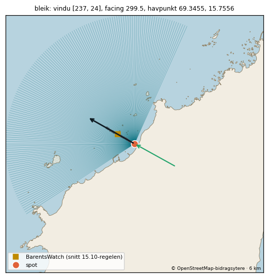

### Broken Hearts (`broken-hearts`) - venter på lokalkunnskap

| | |
|---|---|
| Posisjon | 68.065, 13.52 - listepinnen (ikke kontrollert) |
| Forslag | 68.062539, 13.520075 (claude-flyfoto-2026-10-16, sikkerhet C, ikke godkjent; flyttet 274 m fra listepinnen). Listepinnen sto oppe på Ballstadøya (80 moh). Flyttet ned til ca. 80 m utenfor sørkysten av øya rett sør for pinnen, men flyfotoet viser ingen bølger, så selve revet/odden er ikke funnet. Må sjekkes av noen som kjenner stedet. |
| Sikkerhet | C (forslag, ikke godkjent) |
| Vern/forbud | ingen verneområder innen 2 km av forslaget |
| Usikkert | Listepinnen sto oppe på Ballstadøya (80 moh). Flyttet ned til ca. 80 m utenfor sørkysten av øya rett sør for pinnen, men flyfotoet viser ingen bølger, så selve revet/odden er ikke funnet. Må sjekkes av noen som kjenner stedet. |

### Bunes (`bunes`) - publisert

| | |
|---|---|
| Posisjon | 67.981162, 12.960482 - godkjent forslag (flyfoto), claude (delegert av Theodor 16.10.2026), 2026-10-16. 2066 m fra listepinnen. Listepinnen lå inne i Vindstadfjorden, på feil side av halvøya (derfor «skjermet» i triagen). Bunesstranda er den store sandstranda vest for fjorden, vender mot nordvest; flyfotoet viser brytende bølger. Satt ca. 100 m utenfor midten av stranda. |
| Facing | 331.9° |
| Svellvindu | 271–352° |
| Offshore-vind | 107–197° |
| Havpunkt | 68.0591, 12.7272 (13 km ut i retning 312°) |
| BarentsWatch-punkt | 67.985151, 12.954839 (502 m ut i retning 332°, 9.2 m dyp) Snitt langs facing (data/bw_point_search/result_2026-10-16T0950_kandidater.json), regelen fra 15.10: snitt 500m@331.9, 500 m ut, dybde 9,2 m, Hs 5,04 m kl. 2026-10-17T00:00Z. |
| Eksponering | vindu 81° bredt, facing 20° fra midten; ingen geometrisk grunnlinje ennå - henteren bruker vindu og skyggekurve som reserve |
| Tidevannssted | Andenes (-10 min), faktor 1.05 |
| Høyder | ideal [0.8, 2.0], maks 3.5 |
| Vern/forbud | Lofotodden nasjonalpark, spoten ligger inne i området (listepinnen: 531 m): ingen ferdselsforbud; varsom ferdsel |
| Sikkerhet | A |
| Usikkert | offshore-vind: standard, ubekreftet (motsatt av facing ±45°) |

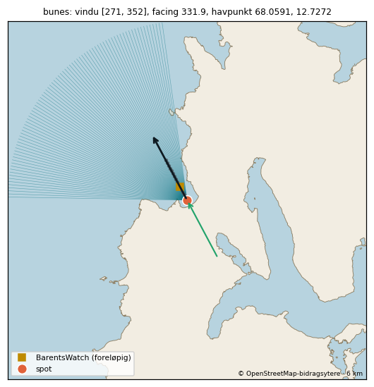

### Ducks (`ducks`) - publisert

| | |
|---|---|
| Posisjon | 69.067999, 15.522294 - godkjent forslag (flyfoto), claude (delegert av Theodor 16.10.2026), 2026-10-16. 0 m fra listepinnen. Steinete odde, ikke sandstrand. Listepinnen (eksakt i lista) ligger i vannet langs den nordvestvendte steinkanten og er beholdt. |
| Facing | 323.0° |
| Svellvindu | 252–22° |
| Offshore-vind | 98–188° |
| Havpunkt | 69.1408, 15.3337 (11 km ut i retning 317°) |
| BarentsWatch-punkt | 69.073055, 15.511701 (702 m ut i retning 323°, 17.6 m dyp) Snitt langs facing (data/bw_point_search/result_2026-10-16T0950_kandidater.json), regelen fra 15.10: snitt 700m@323.0, 700 m ut, dybde 17,6 m, Hs 6,72 m kl. 2026-10-16T06:00Z. |
| Eksponering | vindu 130° bredt, facing 6° fra midten; ingen geometrisk grunnlinje ennå - henteren bruker vindu og skyggekurve som reserve |
| Tidevannssted | Andenes (-5 min), faktor 1.00 |
| Høyder | ideal [0.8, 2.0], maks 3.5 |
| Vern/forbud | ingen verneområder innen 2 km av spoten |
| Sikkerhet | B |
| Usikkert | offshore-vind: standard, ubekreftet (motsatt av facing ±45°) |

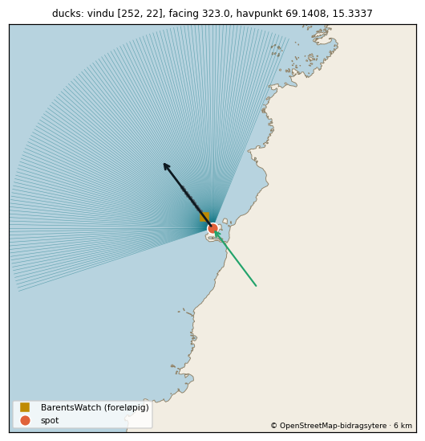

### Eggum (`eggum`) - publisert

| | |
|---|---|
| Posisjon | 68.310696, 13.654805 - godkjent forslag (flyfoto), claude (delegert av Theodor 16.10.2026), 2026-10-16. 0 m fra listepinnen. Listepinnen (eksakt) ligger like utenfor den vestre kurven av steinstranda ved Eggum og er beholdt. NB: Claude Code fant et naturreservat med surfeforbud ca. 280 m unna; grensen må sjekkes. |
| Facing | 330.7° |
| Svellvindu | 234–31° |
| Offshore-vind | 106–196° |
| Havpunkt | 68.3718, 13.4756 (10 km ut i retning 313°) |
| BarentsWatch-punkt | 68.319372, 13.64172 (1104 m ut i retning 331°, 13.0 m dyp) Snitt langs facing (data/bw_point_search/result_2026-10-16T0950_kandidater.json), regelen fra 15.10: snitt 1100m@330.7, 1100 m ut, dybde 13,0 m, Hs 4,54 m kl. 2026-10-16T06:00Z. |
| Eksponering | vindu 157° bredt, facing 18° fra midten; ingen geometrisk grunnlinje ennå - henteren bruker vindu og skyggekurve som reserve |
| Tidevannssted | Andenes (-5 min), faktor 1.01 |
| Høyder | ideal [0.8, 2.0], maks 3.5 |
| Vern/forbud | Eggum naturreservat, 277 m fra spoten: surfeforbud (sjø, § 3 nr. 3) Merknad fra kandidatlista (skrevet om listepinnen): Listepinnen ligger ca. 270 m utenfor Eggum naturreservat (surfebrett forbudt hele året, forskrift 2002-12-06-1447 § 3 nr. 3), som begynner sørvest for pinnen og går ned til strandlinja og ut i sjøen. Ikke sjekket på flyfoto: ligger bølgen lenger sørvest enn pinnen, kan den være innenfor. |
| Sikkerhet | B |
| Usikkert | offshore-vind: standard, ubekreftet (motsatt av facing ±45°) |

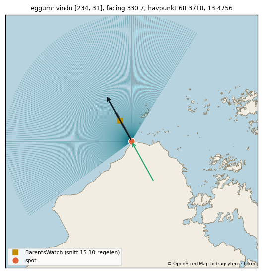

### Eggum øst (steinstrand) (`eggum-ost-steinstrand`) - parkert

| | |
|---|---|
| Posisjon | 68.31067, 13.668266 - godkjent forslag (flyfoto), claude (delegert av Theodor 16.10.2026), 2026-10-16. 315 m fra listepinnen. Steinstranda øst for Eggum. Listepinnen (anslått) lå ca. 380 m ut; flyttet inn til ca. 70 m utenfor stranda på samme lengdegrad. |
| Facing | 11.5° |
| Svellvindu | 283–31° |
| Offshore-vind | 146–236° |
| Havpunkt | 68.4022, 13.5638 (11 km ut i retning 337°) |
| BarentsWatch-punkt | ikke funnet (se «Usikkert») Snitt langs facing (data/bw_point_search/result_2026-10-16T1118_kandidater.json): regelen fant ikke noe punkt i noen time. |
| Eksponering | vindu 108° bredt, facing 34° fra midten; ingen geometrisk grunnlinje ennå - henteren bruker vindu og skyggekurve som reserve |
| Tidevannssted | Andenes (-5 min), faktor 1.01 |
| Høyder | ideal [0.8, 2.0], maks 3.5 |
| Vern/forbud | Eggum naturreservat, 427 m fra spoten (listepinnen: 689 m): surfeforbud (sjø, § 3 nr. 3) Merknad fra kandidatlista (skrevet om listepinnen): Listepinnen ligger ca. 690 m utenfor Eggum naturreservat (surfebrett forbudt hele året). Ikke sjekket på flyfoto - forutsetter at pinnen står der bølgen er. |
| Sikkerhet | B |
| Usikkert | BarentsWatch: regelen fant ikke noe punkt (Hs flater ikke ut / for grunt / retning) - Theodor må velge offshore-vind: standard, ubekreftet (motsatt av facing ±45°) barentswatch_point rettet: nytt snitt langs 11.5° (kontrollør 16.10: Eggums punkt 1 458 m unna, retning 57-103° fra facing - eget snitt langs facing (Claude, delegert)) Parkeres. Eggums BarentsWatch-punkt ligger 1 458 m unna med bølger fra 268-314° (57-103° fra facing 11,5°, retningsfaktor ca. 0). Eget snitt langs facing (16.10, result_2026-10-16T1118_kandidater.json) fant ikke noe punkt: grunn hylle 6-7 m dyp og skjær 1,2-1,4 km ut, aldri 8 m innen 1,5 km. Tas opp igjen med et lengre snitt eller et punkt utenfor skjærene (Theodor velger). |

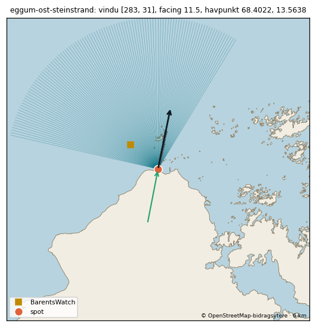

### Flakstad Beach (kirkesiden) (`flakstad-beach-kirkesiden`) - parkert

| | |
|---|---|
| Posisjon | 68.106802, 13.315408 - godkjent forslag (flyfoto), claude (delegert av Theodor 16.10.2026), 2026-10-16. 245 m fra listepinnen. Sandstranda på østsiden av halvøya (mot Flakstad kirke). Listepinnen (anslått) lå ute blant skjærene nord i bukta; flyttet til ca. 100 m utenfor midten av stranda. |
| Facing | 50.2° |
| Svellvindu | – |
| Offshore-vind | 185–275° |
| Havpunkt | – |
| BarentsWatch-punkt | ikke funnet (se «Usikkert») |
| Eksponering | ingen fri linje til åpent hav; ingen geometrisk grunnlinje ennå - henteren bruker vindu og skyggekurve som reserve |
| Tidevannssted | Andenes (-5 min), faktor 1.02 |
| Høyder | ideal [0.8, 2.0], maks 3.5 |
| Vern/forbud | ingen verneområder innen 2 km av spoten |
| Sikkerhet | B |
| Usikkert | ingen retning med fri linje til åpent hav (150 km) ingen snittpunkt med EMODnet-dybde ≥ 8 m innen 1,5 km offshore-vind: standard, ubekreftet (motsatt av facing ±45°) Parkeres. Ligger i le bak halvøya og får bare dønning som brekker rundt odden (wrap). Fabrikken finner ingen fri linje til havet, så ratingen ville alltid vist «Treffer ikke». Tas opp igjen når vi har en modell for wrap. |

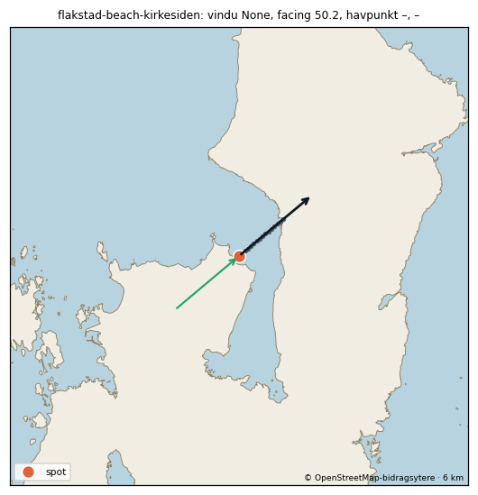

### G-force (`g-force`) - venter på lokalkunnskap

| | |
|---|---|
| Posisjon | 68.6381, 14.4251 - listepinnen (ikke kontrollert) |
| Forslag | 68.638103, 14.425098 (claude-flyfoto-2026-10-16, sikkerhet C, ikke godkjent; flyttet 0 m fra listepinnen). Listepinnen (eksakt) er beholdt, men den ligger foran steinkanten sør for den lille sandstranda. Kan høre til foran stranda ca. 100 m nordøst. |
| Sikkerhet | C (forslag, ikke godkjent) |
| Vern/forbud | ingen verneområder innen 2 km av forslaget |
| Usikkert | Listepinnen (eksakt) er beholdt, men den ligger foran steinkanten sør for den lille sandstranda. Kan høre til foran stranda ca. 100 m nordøst. |

### G-frame (`g-frame`) - holdt tilbake

| | |
|---|---|
| Posisjon | 68.6389, 14.427489 - godkjent forslag (flyfoto), claude (delegert av Theodor 16.10.2026), 2026-10-16. 0 m fra listepinnen. Rev i bukta ved Gimstad/Skagen. Listepinnen (eksakt) ligger over grunnområdet ca. 70 m fra land og er beholdt. |
| Facing | 330.0° |
| Svellvindu | 246–334° |
| Offshore-vind | 105–195° |
| Havpunkt | 68.6791, 14.1262 (13 km ut i retning 290°) |
| BarentsWatch-punkt | 68.653782, 14.40406 (1907 m ut i retning 330°, 9.9 m dyp) Flyttet til 1900 m ut i snittet langs 330.0° (dybde 9.9 m) - kontrollørens funn i #22 (Claude, delegert av Theodor 16.10.2026), ukalibrert: 1 400 m lå i et grunnfelt (1 700-1 800 m er 2-3 m dypt), 1 900 m er første punkt utenfor siste grunne. Snitt langs facing (data/bw_point_search/result_2026-10-16T1036_kandidater.json), første punkt med dybde ≥ 6 m og BarentsWatch-data (retting fra gjennomgangen): snitt 1400m@330.0, 1400 m ut, dybde 6,0 m. |
| Eksponering | vindu 88° bredt, facing 40° fra midten; ingen geometrisk grunnlinje ennå - henteren bruker vindu og skyggekurve som reserve |
| Tidevannssted | Andenes (-5 min), faktor 1.00 |
| Høyder | ideal [1.0, 2.5], maks 3.5 |
| Vern/forbud | ingen verneområder innen 2 km av spoten |
| Sikkerhet | B |
| Usikkert | Holdt tilbake (Theodors ja 16.10, chat): retningen ved BarentsWatch-punktet 1 900 m ut (251-284° i prøvevarselet 16.10 11Z) ligger 46-79° fra facing 330 → retningsfaktor 0-0,6. Slås på når retningen ved punktet er avklart. BarentsWatch-punktet ligger 1907 m ut, utenfor fabrikkens 1,5 km: lavere sikkerhet offshore-vind: standard, ubekreftet (motsatt av facing ±45°) ideal_height [1.0, 2.5] / max_height 3.5: forslag fra Claude 16.10, ukalibrert barentswatch_point rettet: 1900 m ut (kontrollørens funn i #22 (Claude, delegert av Theodor 16.10.2026), ukalibrert: 1 400 m lå i et grunnfelt (1 700-1 800 m er 2-3 m dypt), 1 900 m er første punkt utenfor siste grunne) |

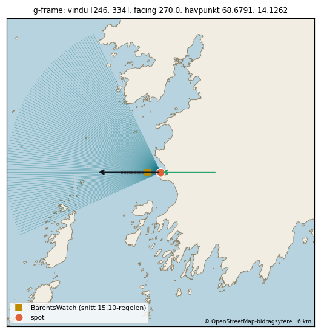

### Haukland (`haukland`) - publisert

| | |
|---|---|
| Posisjon | 68.197515, 13.525391 - godkjent forslag (flyfoto), claude (delegert av Theodor 16.10.2026), 2026-10-16. 791 m fra listepinnen. Listepinnen sto oppe i fjellet (218 moh). Hauklandstranda er den nordre sandstranda i bukta, der veien svinger; pinnen er satt ca. 100 m utenfor midten av den. Vik-stranda ligger rett sør i samme bukt. |
| Facing | 225.0° |
| Svellvindu | 252–276° |
| Offshore-vind | 0–90° |
| Havpunkt | 68.1729, 12.9 (26 km ut i retning 264°) |
| BarentsWatch-punkt | 68.194957, 13.51855 (401 m ut i retning 225°, 8.0 m dyp) Snitt langs facing (data/bw_point_search/result_2026-10-16T0950_kandidater.json), regelen fra 15.10: snitt 400m@225.0, 400 m ut, dybde 8,0 m, Hs 1,27 m kl. 2026-10-16T06:00Z. |
| Eksponering | vindu 24° bredt, facing 39° fra midten; ingen geometrisk grunnlinje ennå - henteren bruker vindu og skyggekurve som reserve |
| Tidevannssted | Andenes (-5 min), faktor 1.07 |
| Høyder | ideal [0.8, 2.0], maks 3.5 |
| Vern/forbud | ingen verneområder innen 2 km av spoten |
| Sikkerhet | B |
| Usikkert | facing 225.0° ligger 27° utenfor eget svellvindu (252–276°) offshore-vind: standard, ubekreftet (motsatt av facing ±45°) |

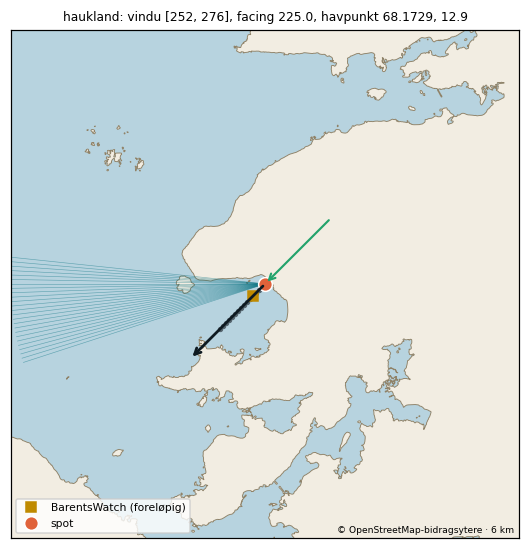

### Horseid (`horseid`) - publisert

| | |
|---|---|
| Posisjon | 68.02655, 12.986765 - godkjent forslag (flyfoto), claude (delegert av Theodor 16.10.2026), 2026-10-16. 904 m fra listepinnen. Listepinnen sto oppe i fjellet (ca. 400 moh). Horseidstranda er den store sandstranda i bukta sørvest for pinnen; satt ca. 100 m utenfor midten av stranda. |
| Facing | 305.0° |
| Svellvindu | 308–4° |
| Offshore-vind | 80–170° |
| Havpunkt | 68.1505, 12.8403 (15 km ut i retning 336°) |
| BarentsWatch-punkt | 68.028625, 12.978899 (400 m ut i retning 305°, 9.5 m dyp) Snitt langs facing (data/bw_point_search/result_2026-10-16T1029_kandidater.json), regelen fra 15.10: snitt 400m@305.0, 400 m ut, dybde 9,5 m, Hs 4,16 m kl. 2026-10-17T00:00Z. |
| Eksponering | vindu 56° bredt, facing 31° fra midten; ingen geometrisk grunnlinje ennå - henteren bruker vindu og skyggekurve som reserve |
| Tidevannssted | Andenes (-10 min), faktor 1.05 |
| Høyder | ideal [0.8, 2.0], maks 3.5 |
| Vern/forbud | Lofotodden nasjonalpark, spoten ligger inne i området: ingen ferdselsforbud; varsom ferdsel |
| Sikkerhet | B |
| Usikkert | facing 305.0° ligger 3° utenfor eget svellvindu (308–4°) offshore-vind: forslag fra Claude 16.10, ukalibrert facing rettet: forslag fra Claude 16.10, ukalibrert offshore_wind rettet: forslag fra Claude 16.10, ukalibrert barentswatch_point rettet: nytt snitt langs 305.0° (forslag fra Claude 16.10, ukalibrert) |

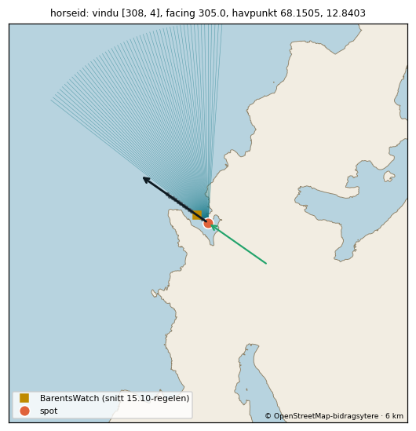

### Høyvika (`hoyvika`) - publisert

| | |
|---|---|
| Posisjon | 69.233414, 15.863562 - godkjent forslag (flyfoto), claude (delegert av Theodor 16.10.2026), 2026-10-16. 280 m fra listepinnen. Sandstrand som vender mot vest. Listepinnen lå ca. 400 m ute på dypt vann; flyttet inn til ca. 90 m utenfor vannkanten foran den nordre delen av stranda, der bunnen er sand. |
| Facing | 261.5° |
| Svellvindu | 233–296° |
| Offshore-vind | 36–126° |
| Havpunkt | 69.223, 15.5609 (12 km ut i retning 265°) |
| BarentsWatch-punkt | 69.232612, 15.848527 (599 m ut i retning 261°, 8.8 m dyp) Snitt langs facing (data/bw_point_search/result_2026-10-16T0950_kandidater.json), regelen fra 15.10: snitt 600m@261.5, 600 m ut, dybde 8,8 m, Hs 4,50 m kl. 2026-10-16T06:00Z. |
| Eksponering | vindu 63° bredt, facing 3° fra midten; ingen geometrisk grunnlinje ennå - henteren bruker vindu og skyggekurve som reserve |
| Tidevannssted | Andenes, faktor 1.00 |
| Høyder | ideal [0.8, 2.0], maks 3.5 |
| Vern/forbud | ingen verneområder innen 2 km av spoten |
| Sikkerhet | B |
| Usikkert | offshore-vind: standard, ubekreftet (motsatt av facing ±45°) |

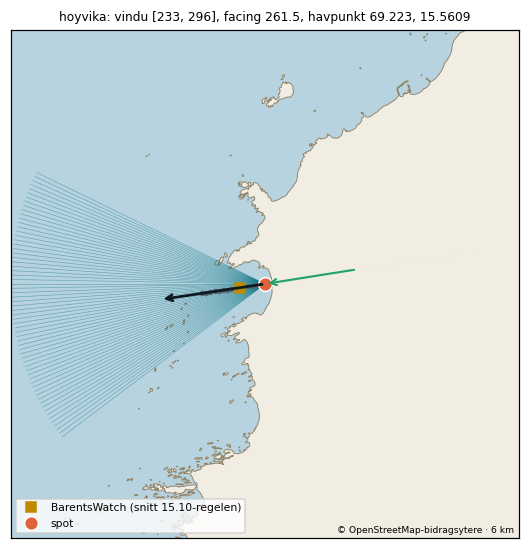

### Kvalnes (`kvalnes`) - publisert

| | |
|---|---|
| Posisjon | 68.344902, 13.929991 - godkjent forslag (flyfoto), claude (delegert av Theodor 16.10.2026), 2026-10-16. 0 m fra listepinnen. Stein- og grusstrand som vender mot nord. Listepinnen (eksakt) ligger ca. 40 m ut midt på stranda og er beholdt. |
| Facing | 346.2° |
| Svellvindu | 269–23° |
| Offshore-vind | 121–211° |
| Havpunkt | 68.4274, 13.7803 (11 km ut i retning 326°) |
| BarentsWatch-punkt | 68.347537, 13.928249 (302 m ut i retning 346°, 9.9 m dyp) Snitt langs facing (data/bw_point_search/result_2026-10-16T0950_kandidater.json), regelen fra 15.10: snitt 300m@346.2, 300 m ut, dybde 9,9 m, Hs 4,38 m kl. 2026-10-17T00:00Z. |
| Eksponering | vindu 114° bredt, facing 20° fra midten; ingen geometrisk grunnlinje ennå - henteren bruker vindu og skyggekurve som reserve |
| Tidevannssted | Andenes (-5 min), faktor 1.01 |
| Høyder | ideal [0.8, 2.0], maks 3.5 |
| Vern/forbud | ingen verneområder innen 2 km av spoten |
| Sikkerhet | B |
| Usikkert | offshore-vind: standard, ubekreftet (motsatt av facing ±45°) |

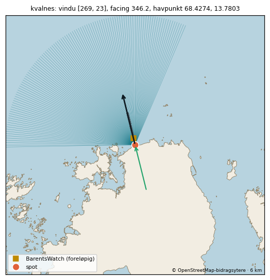

### Kvalvika (`kvalvika`) - publisert

| | |
|---|---|
| Posisjon | 68.077201, 13.092411 - godkjent forslag (flyfoto), claude (delegert av Theodor 16.10.2026), 2026-10-16. 0 m fra listepinnen. Bukta mellom fjellene; flyfotoet viser brytende bølger på den nordre delen av sandstranda der listepinnen (eksakt) ligger. Beholdt. |
| Facing | 307.2° |
| Svellvindu | 270–348° |
| Offshore-vind | 82–172° |
| Havpunkt | 68.1512, 12.8493 (13 km ut i retning 309°) |
| BarentsWatch-punkt | 68.080482, 13.080912 (601 m ut i retning 307°, 12.0 m dyp) Snitt langs facing (data/bw_point_search/result_2026-10-16T0950_kandidater.json), regelen fra 15.10: snitt 600m@307.2, 600 m ut, dybde 12,0 m, Hs 5,45 m kl. 2026-10-17T00:00Z. |
| Eksponering | vindu 78° bredt, facing 2° fra midten; ingen geometrisk grunnlinje ennå - henteren bruker vindu og skyggekurve som reserve |
| Tidevannssted | Andenes (-10 min), faktor 1.05 |
| Høyder | ideal [0.8, 2.0], maks 3.5 |
| Vern/forbud | Lofotodden nasjonalpark, 87 m fra spoten (listepinnen: 88 m): ingen ferdselsforbud; varsom ferdsel |
| Sikkerhet | A |
| Usikkert | offshore-vind: standard, ubekreftet (motsatt av facing ±45°) |

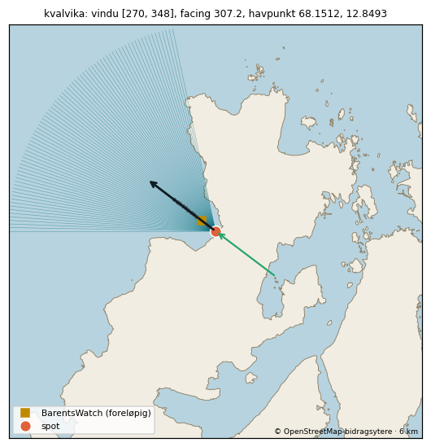

### Ramberg (`ramberg`) - holdt tilbake

| | |
|---|---|
| Posisjon | 68.097007, 13.238991 - godkjent forslag (flyfoto), claude (delegert av Theodor 16.10.2026), 2026-10-16. 876 m fra listepinnen. Rambergstranda, den store hvite sandbukta. Listepinnen (anslått) lå inne på land sørvest for stranda; satt ca. 100 m utenfor midten av stranda. |
| Facing | 287.7° |
| Svellvindu | 297–348° |
| Offshore-vind | 63–153° |
| Havpunkt | 68.2046, 13.0191 (15 km ut i retning 323°) |
| BarentsWatch-punkt | 68.099482, 13.218344 (900 m ut i retning 288°, 9.6 m dyp) Snitt langs facing (data/bw_point_search/result_2026-10-16T0950_kandidater.json), regelen fra 15.10: snitt 900m@287.7, 900 m ut, dybde 9,6 m, Hs 3,22 m kl. 2026-10-17T03:00Z. |
| Eksponering | vindu 51° bredt, facing 35° fra midten; ingen geometrisk grunnlinje ennå - henteren bruker vindu og skyggekurve som reserve |
| Tidevannssted | Andenes, faktor 1.02 |
| Høyder | ideal [0.8, 2.0], maks 3.5 |
| Vern/forbud | ingen verneområder innen 2 km av spoten |
| Sikkerhet | B |
| Usikkert | facing 287.7° ligger 9° utenfor eget svellvindu (297–348°) Holdt tilbake (Theodors ja 10.11.2026): venter på T2b (Unstad mot Flakstad, Lofoten Surfsenter). Facing 315 og offshore [90,180] ligger på grenen region/ramberg-315 og flytter Ramberg fra 0 til 2 stjerner. Slås på når T2b er avgjort. offshore-vind: standard, ubekreftet (motsatt av facing ±45°) |

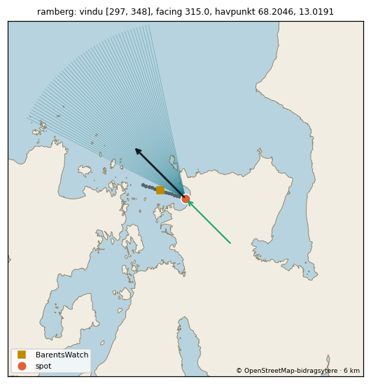

### Rørvika (`rorvika`) - parkert

| | |
|---|---|
| Posisjon | 68.203945, 14.229408 - godkjent forslag (flyfoto), claude (delegert av Theodor 16.10.2026), 2026-10-16. 1995 m fra listepinnen. Listepinnen lå ved munningen av Djupfjorden, ca. 2 km for langt sør. Rørvikstranda er sandbukta ved avkjøringen fra E10 mot Henningsvær (bekreftet av visitlofoten.com), vender mot sørvest. Satt ca. 100 m utenfor midten av stranda. Vender mot Vestfjorden, så den får bare dønning ved kraftig sørvest. |
| Facing | 182.9° |
| Svellvindu | 222–226° + 232–234° |
| Offshore-vind | 318–48° |
| Havpunkt | 67.9893, 13.6748 (33 km ut i retning 224°) |
| BarentsWatch-punkt | ikke funnet (se «Usikkert») Snitt langs facing (data/bw_point_search/result_2026-10-16T0950_kandidater.json): regelen fant ikke noe punkt i noen time. |
| Eksponering | vindu 6° bredt, facing 41° fra midten; ingen geometrisk grunnlinje ennå - henteren bruker vindu og skyggekurve som reserve |
| Tidevannssted | Kabelvåg, faktor 0.98 |
| Høyder | ideal [0.8, 2.0], maks 3.5 |
| Vern/forbud | ingen verneområder innen 2 km av listepinnen |
| Sikkerhet | B |
| Usikkert | facing 182.9° er 50° fra midten av vinduet [232, 234], og nærmeste kystpunkt er 112 m unna - står nålen i hjørnet av en buet strand? Sjekk facing ingen snittpunkt med EMODnet-dybde ≥ 8 m innen 1,5 km BarentsWatch: regelen fant ikke noe punkt (Hs flater ikke ut / for grunt / retning) - Theodor må velge facing 182.9° ligger 39° utenfor eget svellvindu (222–226° + 232–234°) offshore-vind: standard, ubekreftet (motsatt av facing ±45°) Parkeres. Vinduet er bare ca. 6 grader (222-234) mot Vestfjorden, så den vil nesten alltid vise «Treffer ikke», og BarentsWatch fant intet punkt. Vurderes igjen når vi har vindbølgemodell for innaskjærs spots. |

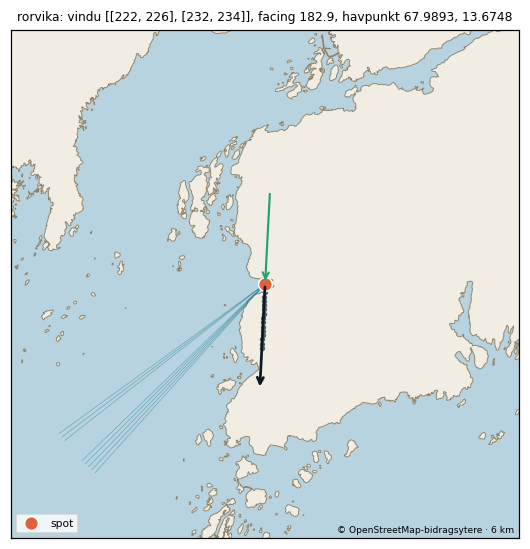

### Skagsanden (`skagsanden`) - publisert

| | |
|---|---|
| Posisjon | 68.10708, 13.290916 - godkjent forslag (flyfoto), claude (delegert av Theodor 16.10.2026), 2026-10-16. 306 m fra listepinnen. Skagsanden er den lange sandstranda på vestsiden av halvøya, vender mot nordvest. Listepinnen lå i vannkanten ved sørenden; flyttet til ca. 100 m utenfor midten av stranda. |
| Facing | 319.2° |
| Svellvindu | 280–4° |
| Offshore-vind | 94–184° |
| Havpunkt | 68.2069, 13.0833 (14 km ut i retning 322°) |
| BarentsWatch-punkt | 68.110503, 13.283045 (501 m ut i retning 319°, 9.3 m dyp) Snitt langs facing (data/bw_point_search/result_2026-10-16T0950_kandidater.json), regelen fra 15.10: snitt 500m@319.2, 500 m ut, dybde 9,3 m, Hs 3,59 m kl. 2026-10-17T03:00Z. |
| Eksponering | vindu 84° bredt, facing 3° fra midten; ingen geometrisk grunnlinje ennå - henteren bruker vindu og skyggekurve som reserve |
| Tidevannssted | Andenes (-5 min), faktor 1.02 |
| Høyder | ideal [0.8, 2.0], maks 3.5 |
| Vern/forbud | ingen verneområder innen 2 km av spoten |
| Sikkerhet | B |
| Usikkert | offshore-vind: standard, ubekreftet (motsatt av facing ±45°) |

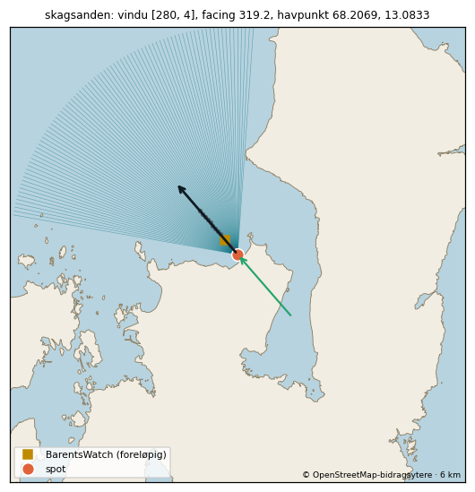

### Søppelplassen (`soppelplassen`) - holdt tilbake

| | |
|---|---|
| Posisjon | 68.265958, 13.558251 - godkjent forslag (flyfoto), claude (delegert av Theodor 16.10.2026), 2026-10-16. 74 m fra listepinnen. Steinkysten sørvest for Unstad-odden. Flyfotoet viser bølger som brekker langs kanten; pinnen er flyttet ca. 60 m inn mot der skummet starter. |
| Facing | 294.8° |
| Svellvindu | 262–6° |
| Offshore-vind | 70–209° |
| Havpunkt | 68.3351, 13.3663 (11 km ut i retning 314°) |
| BarentsWatch-punkt | 68.269442, 13.555641 (402 m ut i retning 344°, 10.1 m dyp) Snitt langs facing (data/bw_point_search/result_2026-10-16T0950_kandidater.json), regelen fra 15.10: snitt 400m@344.4, 400 m ut, dybde 10,1 m, Hs 4,87 m kl. 2026-10-16T06:00Z. Beholdt ved ny facing 300.0°: reef på sørvestsiden av Unstad-bukta - bølgene ved punktet kom fra 282-315°. Beholdt ved ny facing 294.8°: punktet beholdt (point/reef i Unstad-bukta). |
| Eksponering | vindu 104° bredt, facing 19° fra midten; ingen geometrisk grunnlinje ennå - henteren bruker vindu og skyggekurve som reserve |
| Tidevannssted | Andenes (-5 min), faktor 1.01 |
| Høyder | ideal [1.5, 3.5], maks 5.0 |
| Vern/forbud | ingen verneområder innen 2 km av spoten |
| Sikkerhet | B |
| Usikkert | Holdt tilbake (kontrollør 16.10, Claude delegert): i prøvevarselet 16.10 11Z gir spoten 3,4-4,2 m mens Unstad 250-600 m unna gir 1,6-1,8 m samme time (Unstads BarentsWatch-punkt ligger trolig i brytesonen - ROADMAP N). Slås på når Theodor har avgjort Unstads punkt/prior, eller med Theodors ja til å publisere med merknad. BarentsWatch-punktet ligger i retning 344°, 50° fra facing 294.8° (snittet og de grå prikkene på minikartet følger retningen snittet ble tatt i) offshore-vind: kontrollør 16.10 andre runde (Claude, delegert av Theodor 16.10.2026), ukalibrert: Unstads egen facing (har observasjoner bak seg) i stedet for retningen ved punktet én dag. NB: retningen ved punktet ligger innen 23° av 294,8 i hele prøvevarselet, og bw_confirms slo til i 56 av 56 timer - retningskontrollen er i praksis av for denne spoten; sørvestlig (<247°) og nordlig (>353°) svell er ikke testet; offshore [70,209]: geometrisk offshore for 294,8 (70-160) pluss land bak i sør som før (til 209) - S/SSV-kanaliseringen fra Unstad-observasjonene (til 232) er ikke overført til denne siden av bukta ideal_height [1.5, 3.5] / max_height 5.0: forslag fra Claude 16.10, ukalibrert facing rettet: kontrollør 16.10 andre runde (Claude, delegert av Theodor 16.10.2026), ukalibrert: Unstads egen facing (har observasjoner bak seg) i stedet for retningen ved punktet én dag. NB: retningen ved punktet ligger innen 23° av 294,8 i hele prøvevarselet, og bw_confirms slo til i 56 av 56 timer - retningskontrollen er i praksis av for denne spoten; sørvestlig (<247°) og nordlig (>353°) svell er ikke testet; offshore [70,209]: geometrisk offshore for 294,8 (70-160) pluss land bak i sør som før (til 209) - S/SSV-kanaliseringen fra Unstad-observasjonene (til 232) er ikke overført til denne siden av bukta barentswatch_point rettet: beholdt ved ny facing (punktet beholdt (point/reef i Unstad-bukta)) offshore_wind rettet: kontrollør 16.10 andre runde (Claude, delegert av Theodor 16.10.2026), ukalibrert: Unstads egen facing (har observasjoner bak seg) i stedet for retningen ved punktet én dag. NB: retningen ved punktet ligger innen 23° av 294,8 i hele prøvevarselet, og bw_confirms slo til i 56 av 56 timer - retningskontrollen er i praksis av for denne spoten; sørvestlig (<247°) og nordlig (>353°) svell er ikke testet; offshore [70,209]: geometrisk offshore for 294,8 (70-160) pluss land bak i sør som før (til 209) - S/SSV-kanaliseringen fra Unstad-observasjonene (til 232) er ikke overført til denne siden av bukta |

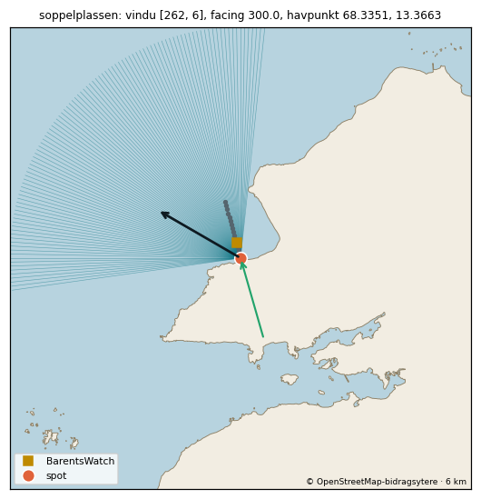

### Stave (`stave`) - publisert

| | |
|---|---|
| Posisjon | 69.205654, 15.856756 - godkjent forslag (flyfoto), claude (delegert av Theodor 16.10.2026), 2026-10-16. 279 m fra listepinnen. Listepinnen sto på land ved campingen. Flyttet ut til ca. 100 m utenfor vannkanten midt på Stavestranda (sandbunn med revstriper). |
| Facing | 266.4° |
| Svellvindu | 237–342° |
| Offshore-vind | 41–131° |
| Havpunkt | 69.2419, 15.5705 (12 km ut i retning 290°) |
| BarentsWatch-punkt | 69.205143, 15.834028 (899 m ut i retning 266°, 8.1 m dyp) Snitt langs facing (data/bw_point_search/result_2026-10-16T0950_kandidater.json), regelen fra 15.10: snitt 900m@266.4, 900 m ut, dybde 8,1 m, Hs 3,60 m kl. 2026-10-16T06:00Z. |
| Eksponering | vindu 105° bredt, facing 23° fra midten; ingen geometrisk grunnlinje ennå - henteren bruker vindu og skyggekurve som reserve |
| Tidevannssted | Andenes, faktor 1.00 |
| Høyder | ideal [0.8, 2.0], maks 3.5 |
| Vern/forbud | Skogvoll naturreservat, 1393 m fra spoten (listepinnen: 1504 m): forskriften ikke lest |
| Sikkerhet | B |
| Usikkert | offshore-vind: standard, ubekreftet (motsatt av facing ±45°) |

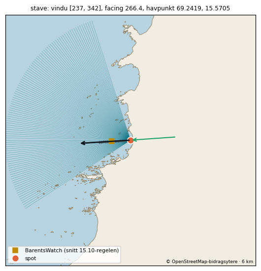

### The Frog (`the-frog`) - publisert

| | |
|---|---|
| Posisjon | 68.757033, 14.469888 - godkjent forslag (flyfoto), claude (delegert av Theodor 16.10.2026), 2026-10-16. 66 m fra listepinnen. Liten sandstrand i bukta ved Nykvåg, vender mot vest/sørvest. Flyttet fra nordenden til midt på stranda, ca. 80 m ut. NB: Nykan naturreservat ligger ca. 580 m unna. |
| Facing | 250.0° |
| Svellvindu | 220–275° |
| Offshore-vind | 25–115° |
| Havpunkt | 68.7051, 14.1263 (15 km ut i retning 248°) |
| BarentsWatch-punkt | 68.756414, 14.465228 (200 m ut i retning 250°, 9.3 m dyp) Snitt langs facing (data/bw_point_search/result_2026-10-16T0950_kandidater.json), regelen fra 15.10: snitt 200m@250.0, 200 m ut, dybde 9,3 m, Hs 2,97 m kl. 2026-10-16T06:00Z. |
| Eksponering | vindu 55° bredt, facing 2° fra midten; ingen geometrisk grunnlinje ennå - henteren bruker vindu og skyggekurve som reserve |
| Tidevannssted | Andenes (-5 min), faktor 1.00 |
| Høyder | ideal [0.8, 2.0], maks 3.5 |
| Vern/forbud | Nykvåg/Nykan naturreservat, 626 m fra spoten (listepinnen: 579 m): surfeforbud (sjø, § 3 nr. 5); ferdselsforbud (strand, § 3 nr. 4) Merknad fra kandidatlista (skrevet om listepinnen): Listepinnen ligger ca. 580 m utenfor Nykvåg/Nykan naturreservat (surfebrett forbudt hele året, ferdsel på land forbudt 15.4-31.7; forskrift 2002-12-06-1462), som ligger på andre siden av bukta. Ikke sjekket på flyfoto - forutsetter at pinnen står der bølgen er. |
| Sikkerhet | B |
| Usikkert | offshore-vind: standard, ubekreftet (motsatt av facing ±45°) |

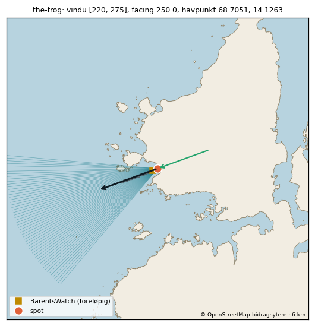

### Unstad (`unstad`) - publisert

| | |
|---|---|
| Posisjon | 68.269216, 13.580785 - spots.json (satt før kandidatlista) |
| Facing | 294.8° |
| Svellvindu | 253–335° |
| Offshore-vind | 70–232° |
| Havpunkt | 68.3134, 13.3148 (12 km ut i retning 294°) |
| BarentsWatch-punkt | 68.270164, 13.575278 (250 m ut i retning 295°, dybde ukjent) barentswatch_point flyttet til 250 m ut (26.09.2026), samme retning som stranda vender (294,8 grader). barentswatch_point_near er det opprinnelige punktet 150 m ut, navngitt 'Unnstadvika' på barentswatch.no. Bekreft i kilderapporten at 250 m-punktet faktisk gir data. |
| Eksponering | vindu 82° bredt, facing 1° fra midten; geometrisk grunnlinje finnes (data/exposure_baseline.json) |
| Tidevannssted | slås opp av henteren (Kartverket) |
| Høyder | ideal [1.2, 3.5], maks 5.5 |
| Vern/forbud | ingen verneområder innen 2 km av listepinnen |
| Sikkerhet | – (lå i appen før kandidatlista) |
| Usikkert | – |

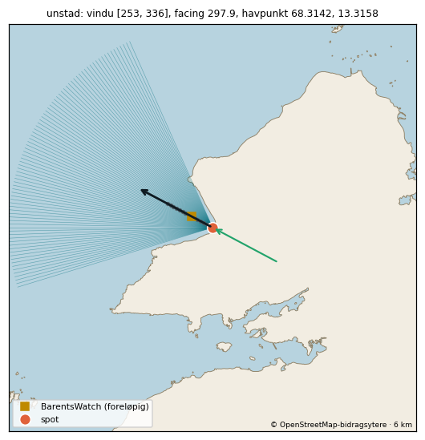

### Unstad Left (`unstad-left`) - holdt tilbake

| | |
|---|---|
| Posisjon | 68.267948, 13.575772 - godkjent forslag (flyfoto), claude (delegert av Theodor 16.10.2026), 2026-10-16. 290 m fra listepinnen. Venstrebølgen ved den søndre odden. Flyfotoet viser brytende bølger som brekker inn langs revet; pinnen er flyttet fra ca. 250 m ute i bukta til der skummet starter på revet. |
| Facing | 294.8° |
| Svellvindu | 257–344° |
| Offshore-vind | 70–232° |
| Havpunkt | 68.323, 13.3249 (12 km ut i retning 301°) |
| BarentsWatch-punkt | 68.273657, 13.568434 (703 m ut i retning 335°, 9.4 m dyp) Snitt langs facing (data/bw_point_search/result_2026-10-16T0950_kandidater.json), regelen fra 15.10: snitt 700m@334.4, 700 m ut, dybde 9,4 m, Hs 4,92 m kl. 2026-10-16T06:00Z. Beholdt ved ny facing 285.0°: point/reef i sørøsthjørnet av Unstad-bukta - strandnormalen 334,4 var feil mål; bølgene ved punktet kom fra 276-289°. Beholdt ved ny facing 294.8°: punktet beholdt (point/reef i Unstad-bukta). |
| Eksponering | vindu 87° bredt, facing 6° fra midten; ingen geometrisk grunnlinje ennå - henteren bruker vindu og skyggekurve som reserve |
| Tidevannssted | Andenes (-5 min), faktor 1.01 |
| Høyder | ideal [1.5, 3.5], maks 5.0 |
| Vern/forbud | ingen verneområder innen 2 km av spoten |
| Sikkerhet | A |
| Usikkert | Holdt tilbake (kontrollør 16.10, Claude delegert): i prøvevarselet 16.10 11Z gir spoten 3,4-4,2 m mens Unstad 250-600 m unna gir 1,6-1,8 m samme time (Unstads BarentsWatch-punkt ligger trolig i brytesonen - ROADMAP N). Slås på når Theodor har avgjort Unstads punkt/prior, eller med Theodors ja til å publisere med merknad. BarentsWatch-punktet ligger i retning 335°, 40° fra facing 294.8° (snittet og de grå prikkene på minikartet følger retningen snittet ble tatt i) offshore-vind: kontrollørens funn i #22 (Claude, delegert av Theodor 16.10.2026), ukalibrert: offshore-sektor som Unstad (samme dal bak) ideal_height [1.5, 3.5] / max_height 5.0: forslag fra Claude 16.10, ukalibrert facing rettet: kontrollør 16.10 andre runde (Claude, delegert av Theodor 16.10.2026), ukalibrert: Unstads egen facing (har observasjoner bak seg) i stedet for retningen ved punktet én dag. NB: retningen ved punktet ligger innen 23° av 294,8 i hele prøvevarselet, og bw_confirms slo til i 56 av 56 timer - retningskontrollen er i praksis av for denne spoten; sørvestlig (<247°) og nordlig (>353°) svell er ikke testet barentswatch_point rettet: beholdt ved ny facing (punktet beholdt (point/reef i Unstad-bukta)) offshore_wind rettet: kontrollørens funn i #22 (Claude, delegert av Theodor 16.10.2026), ukalibrert: offshore-sektor som Unstad (samme dal bak) |

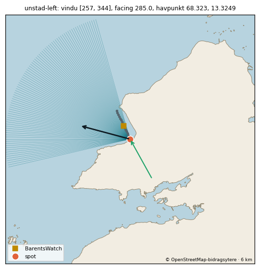

### Unstad Right (`unstad-right`) - holdt tilbake

| | |
|---|---|
| Posisjon | 68.273399, 13.57749 - godkjent forslag (flyfoto), claude (delegert av Theodor 16.10.2026), 2026-10-16. 0 m fra listepinnen. Høyrebølgen fra den nordre steinodden i Unstad-bukta. Flyfotoet viser skum langs odden; listepinnen (eksakt) ligger ved tuppen og er beholdt. |
| Facing | 294.8° |
| Svellvindu | 237–332° |
| Offshore-vind | 70–232° |
| Havpunkt | 68.3006, 13.2956 (12 km ut i retning 285°) |
| BarentsWatch-punkt | 68.270129, 13.562945 (701 m ut i retning 239°, 8.6 m dyp) Snitt langs facing (data/bw_point_search/result_2026-10-16T0950_kandidater.json), regelen fra 15.10: snitt 700m@238.9, 700 m ut, dybde 8,6 m, Hs 4,87 m kl. 2026-10-16T06:00Z. Beholdt ved ny facing 300.0°: point/reef på nordøstsiden av Unstad-bukta - strandnormalen 238,9 var feil mål; punktet 700 m ut ligger der bølgene kommer inn (288-310° i prøvevarselet). Beholdt ved ny facing 294.8°: punktet beholdt (point/reef i Unstad-bukta). |
| Eksponering | vindu 95° bredt, facing 10° fra midten; ingen geometrisk grunnlinje ennå - henteren bruker vindu og skyggekurve som reserve |
| Tidevannssted | Andenes (-5 min), faktor 1.01 |
| Høyder | ideal [1.2, 3.0], maks 4.5 |
| Vern/forbud | ingen verneområder innen 2 km av spoten |
| Sikkerhet | A |
| Usikkert | Holdt tilbake (kontrollør 16.10, Claude delegert): i prøvevarselet 16.10 11Z gir spoten 3,4-4,2 m mens Unstad 250-600 m unna gir 1,6-1,8 m samme time (Unstads BarentsWatch-punkt ligger trolig i brytesonen - ROADMAP N). Slås på når Theodor har avgjort Unstads punkt/prior, eller med Theodors ja til å publisere med merknad. BarentsWatch-punktet ligger i retning 239°, 56° fra facing 294.8° (snittet og de grå prikkene på minikartet følger retningen snittet ble tatt i) offshore-vind: kontrollørens funn i #22 (Claude, delegert av Theodor 16.10.2026), ukalibrert: offshore-sektor som Unstad (S/SSV offshore på alle fem Unstad-observasjonene) ideal_height [1.2, 3.0] / max_height 4.5: forslag fra Claude 16.10, ukalibrert facing rettet: kontrollør 16.10 andre runde (Claude, delegert av Theodor 16.10.2026), ukalibrert: Unstads egen facing (har observasjoner bak seg) i stedet for retningen ved punktet én dag. NB: retningen ved punktet ligger innen 23° av 294,8 i hele prøvevarselet, og bw_confirms slo til i 56 av 56 timer - retningskontrollen er i praksis av for denne spoten; sørvestlig (<247°) og nordlig (>353°) svell er ikke testet barentswatch_point rettet: beholdt ved ny facing (punktet beholdt (point/reef i Unstad-bukta)) offshore_wind rettet: kontrollørens funn i #22 (Claude, delegert av Theodor 16.10.2026), ukalibrert: offshore-sektor som Unstad (S/SSV offshore på alle fem Unstad-observasjonene) |

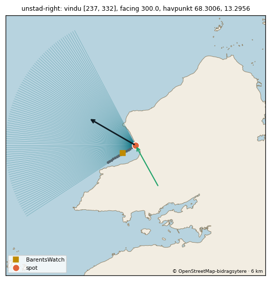

### Utakleiv (`utakleiv`) - publisert

| | |
|---|---|
| Posisjon | 68.21318, 13.503398 - godkjent forslag (flyfoto), claude (delegert av Theodor 16.10.2026), 2026-10-16. 288 m fra listepinnen. Hvit sandstrand som vender mot nordvest. Listepinnen lå ved sørenden mot steinene; flyttet til ca. 100 m utenfor midten av stranda. Hovedtoppen er ukjent. |
| Facing | 292.4° |
| Svellvindu | 245–6° |
| Offshore-vind | 67–157° |
| Havpunkt | 68.2762, 13.2669 (12 km ut i retning 306°) |
| BarentsWatch-punkt | 68.214214, 13.496685 (300 m ut i retning 293°, 10.0 m dyp) Snitt langs facing (data/bw_point_search/result_2026-10-16T0950_kandidater.json), regelen fra 15.10: snitt 300m@292.4, 300 m ut, dybde 10,0 m, Hs 2,82 m kl. 2026-10-16T06:00Z. |
| Eksponering | vindu 121° bredt, facing 13° fra midten; ingen geometrisk grunnlinje ennå - henteren bruker vindu og skyggekurve som reserve |
| Tidevannssted | Andenes (-5 min), faktor 1.01 |
| Høyder | ideal [0.8, 2.0], maks 3.5 |
| Vern/forbud | ingen verneområder innen 2 km av spoten |
| Sikkerhet | B |
| Usikkert | offshore-vind: standard, ubekreftet (motsatt av facing ±45°) |

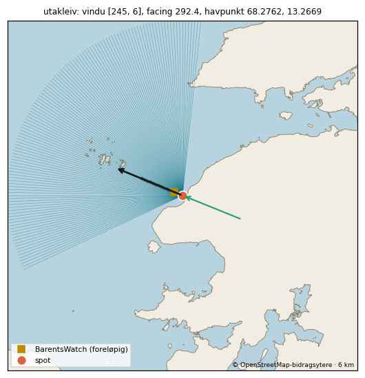

### Vikten (`vikten`) - publisert

| | |
|---|---|
| Posisjon | 68.140622, 13.310596 - godkjent forslag (flyfoto), claude (delegert av Theodor 16.10.2026), 2026-10-16. 243 m fra listepinnen. Lang, smal sandstrand langs vestkysten ved Vikten, vender mot vest. Listepinnen sto ca. 40 m inne på land; flyttet rett ut til ca. 100 m utenfor vannkanten. |
| Facing | 278.5° |
| Svellvindu | 254–2° |
| Offshore-vind | 54–144° |
| Havpunkt | 68.2074, 13.0825 (12 km ut i retning 308°) |
| BarentsWatch-punkt | 68.141023, 13.303437 (300 m ut i retning 279°, 9.5 m dyp) Snitt langs facing (data/bw_point_search/result_2026-10-16T0950_kandidater.json), regelen fra 15.10: snitt 300m@278.5, 300 m ut, dybde 9,5 m, Hs 3,43 m kl. 2026-10-16T06:00Z. |
| Eksponering | vindu 108° bredt, facing 30° fra midten; ingen geometrisk grunnlinje ennå - henteren bruker vindu og skyggekurve som reserve |
| Tidevannssted | Andenes (-5 min), faktor 1.02 |
| Høyder | ideal [0.8, 2.0], maks 3.5 |
| Vern/forbud | ingen verneområder innen 2 km av spoten |
| Sikkerhet | B |
| Usikkert | offshore-vind: standard, ubekreftet (motsatt av facing ±45°) |

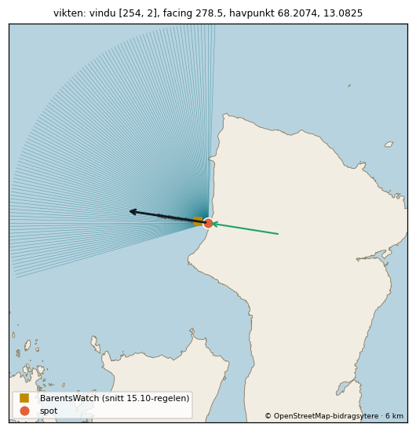

Kyst © OpenStreetMap-bidragsytere og GSHHS; dybde EMODnet Bathymetry; tidevann © Kartverket; bølger BarentsWatch; vern Naturbase (Miljødirektoratet).
