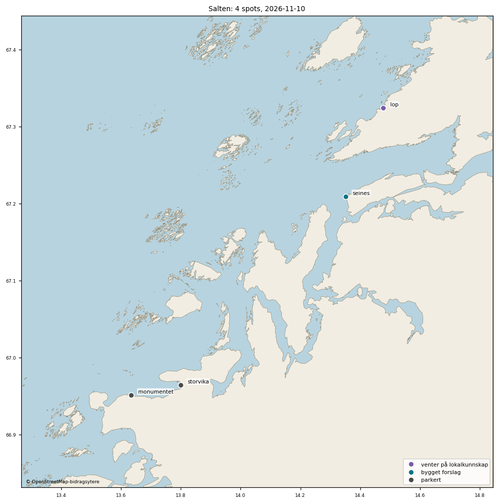
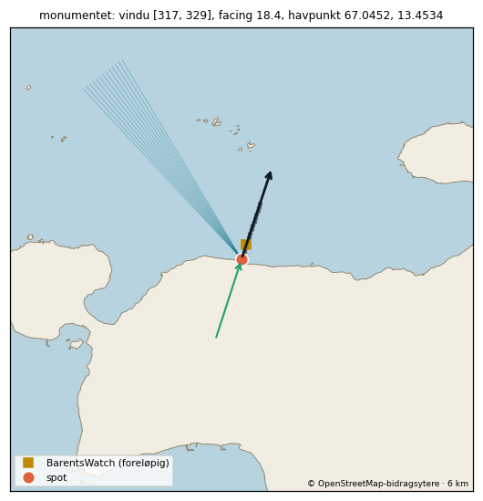
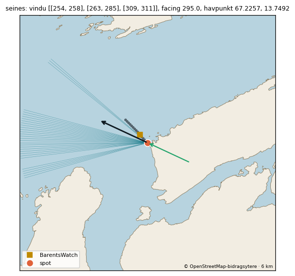
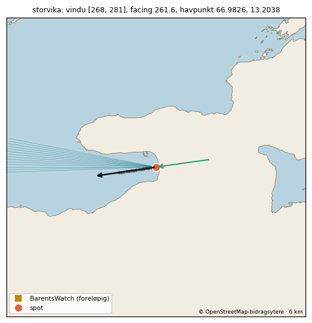

# Gjennomgangspakke: Salten (4 spots)

Laget 2026-11-10 av tools/region_pakke.py fra spots.json (gjelder der spoten ligger inne) og fabrikkens forslag (data/kandidater/bygget/<id>.json). 1 bygget forslag, 2 parkert, 1 venter på lokalkunnskap.

Vindu: fri linje 150 km over GSHHS f (300 m kysttoleranse). Facing: strandnormal ±150 m langs kysten. Offshore-vind: motsatt av facing ±45° når ikke annet står. BarentsWatch-punkt: snittregelen 15.10 (første punkt utover med minst 8 m dyp og flat Hs). Tidevann: Kartverkets referansested for posisjonen. Vern: Naturbase innen 2 km, målt fra spotens posisjon der oppslaget finnes (ellers fra listepinnen, og da står det), forskriften lest på Lovdata. Sikkerhet: A = navn, strandtype, synlig bølge/formasjon og retning stemmer; B = to av fire; C = resten (bygges ikke).

## Posisjonsrunden og gjennomgangen 10.11.2026

Hele svaret fra spotansvarlig ligger i `salten-gjennomgang.csv` (én linje per spot): **0 godkjent, 1 rett, 3 avvis.** Ingenting i spots.json eller appen er endret. Salten har ingen spots i appen fra før.

- **Rett (1):** seines. Posisjonen er godkjent (sikkerhet B) og spoten er bygget. Facing og offshore-vind er rettet, se under.
- **Avvis (3):** monumentet og storvika er bygget, men parkert fordi vinduet er under ca. 15°. lop venter på lokalkunnskap og er ikke bygget.

## seines (point break)

Snittet ble hentet 10.11 kl. 11:35Z (0 til 3 km langs 316,3°, 18 tidspunkter, hver 3. time fra 10.11 kl. 06Z til 12.11 kl. 09Z, `data/bw_point_search/result_2026-11-10T1135_kandidater.json`).

- **Facing er rettet fra 316,3° til 295°.** 316,3° er kystnormalen på spissen. Bølgene ved punktet kom fra 292–298° (400–500 m ut) i de fire tidspunktene regelen fant et punkt, mens svellet ute kom fra 275–281°. Offshore-vinden følger med: 70–160°.
- **295° ligger 10° utenfor hovedsektoren i vinduet (263–285°).** Spotansvarlig godtar det for en point break.
- **BarentsWatch-punktet 500 m ut (8,5 m) er beholdt.** Hs er flat 0,45–0,47 m fra 500 m til 3 km kl. 12Z, og retningen der er 292–294°. Nytt snitt langs 295° tas neste gang snittet kjøres.
- **Lavere sikkerhet:** grunnlaget er fire tidspunkter med lite svell (0,4–0,9 m ute). Ett av dem er vindsjø (2,3 s), så det reelle grunnlaget ved 500 m er tre svelltimer (6,1–6,7 s). Ved 400 m er det åtte timer med 6,2–6,9 s og retning 296–298°, og det styrker 295°. Ellers viser BarentsWatch her mest vindsjø (periode 2–3 s).
- **Virkningen er liten for bølgene:** retningene som er sett ved punktet (292–298° og 317°) ligger under 30° fra både gammel og ny facing. Det som endres i praksis, er at vindsektoren dreies 21°. Facing 295° er ikke bekreftet av en observasjon eller en lokal kilde.
- **Høydene mangler.** Fabrikken setter ikke ideal_height og max_height for point break. Spotansvarlig anbefaler standarden [0,8, 2,0] og maks 3,5 merket ubekreftet til det finnes observasjoner. Det er Theodors avgjørelse.
- **Vern:** spoten ligger inne i Seinesodden naturreservat. Forskriften har ikke ferdselsforbud. Motorferdsel og brettseiling er forbudt hele året, og surfebrett er ikke nevnt. Vi leser brettseiling som seilbrett, så appen viser ikke «Forbud nå». Leser Theodor det annerledes, settes forbudet inn før spoten publiseres. Straumøya naturreservat ligger 1 168 m unna og har de samme bestemmelsene.

## Parkert

| Spot | Hvorfor |
|---|---|
| monumentet | Fri linje til åpent hav er bare ca. 13° (317–329°), og midten av vinduet ligger 46–55° fra kystnormalen (facing 18,4°). Spoten ville nesten alltid vist «Treffer ikke». OSM gir 33° sammenhengende vindu ut til 50 km, så det er kravet om 150 km og avviket fra facing som avgjør. |
| storvika | Stranda ligger innerst i ei lang, smal bukt med fri linje til havet bare gjennom 268–281°, og facing 261,6° ligger utenfor vinduet. Posisjonen er flyttet 3,9 km fra listepinnen. EMODnet gir 12,4 m dybde på selve posisjonen, og det er ikke forklart. |

Begrunnelsene står i `data/kandidater/status_overstyring.json`. BarentsWatch-snitt er ikke kjørt for de to, så punktene deres er foreløpige (bare dybde).

## Hva som skal til

| Spot | Hva som mangler | Hvem |
|---|---|---|
| seines | Theodors ja til regionen og til høydene. Da settes spoten inn i spots.json (`tools/godkjenn_spot.py`), og det kjøres én prøvehenting før merge. | Theodor |
| monumentet, storvika | Lokalkunnskap om hvor bølgen brekker, eller en modell for wrap og innaskjærs vindbølger. | Senere |
| lop | Bukta ligger innaskjærs med 7° vindu. Noen må vite hvor og når det brekker. | Lokalkunnskap |

## Ikke sjekket

- Flyfotoene er ikke sett på nytt etter posisjonsrunden. Gjennomgangen bygger på minikart, OSM-kyst og snittet.
- EMODnet og BarentsWatch bruker ikke samme bunn, så 8 m-kravet er testet mot en annen bunn enn Hs-profilen.

## Oversikt

| id | Navn | Region | Status | Sikkerhet | facing | Vindu | Offshore-vind | BarentsWatch-punkt |
|---|---|---|---|---|---|---|---|---|
| lop | Løp | Salten | venter på lokalkunnskap | B (forslag, ikke godkjent) | – | – | – | – |
| monumentet | Monumentet | Salten | parkert | B | 18.4° | 317–329° | 153–243° | foreløpig: 66.954711, 13.635797 (402 m ut i retning 18°, 8.8 m dyp) |
| seines | Seines | Salten | bygget forslag | B | 295.0° | 254–258° + 263–285° + 309–311° | 70–160° | 67.212592, 14.342707 (501 m ut i retning 316°, 8.5 m dyp) |
| storvika | Storvika | Salten | parkert | B | 261.6° | 268–281° | 37–127° | foreløpig: 66.964147, 13.798879 (0 m ut i retning 0°, 12.4 m dyp) |

## Holdes tilbake, parkert eller ikke bygget

| id | Status | Hvorfor |
|---|---|---|
| lop | venter på lokalkunnskap | Listepinnen er beholdt, men bukta ligger innaskjærs. Med skjær (OSM) er bare enkeltgrader åpne mot vest ved 150 km (9° ved 50 km), og GSHHS gir 7° (272-278°), mens hintet sier dønning fra V-SV og Bremneshalvøya stenger for sørvest. Alternativet Bremnesstranda er ikke klart bedre når skjærene regnes med (OSM 2° ved 150 km), og kildene heter «Lop camping», så det trengs lokalkunnskap om hvor og når det brekker. |
| monumentet | parkert | Parkeres. Fri linje til åpent hav er bare ca. 13° (317-329 i både GSHHS og OSM ved 150 km), og midten av vinduet ligger 46-55° fra kystnormalen (facing 18,4; OSM 9-18), så spoten ville nesten alltid vist «Treffer ikke». Tas opp igjen med lokalkunnskap om hvor bølgen brekker, eller når vi har modell for wrap. |
| storvika | parkert | Parkeres. Stranda ligger innerst i ei lang, smal bukt med fri linje til havet bare gjennom 268-281 (14° i GSHHS, 11° med OSM), og facing 261,6 ligger utenfor dette vinduet, så spoten ville nesten alltid vist «Treffer ikke». Tas opp igjen med lokalkunnskap eller vindbølgemodell for innaskjærs spots. |

## Kallbudsjett

| | Spots | Open-Meteo vektet per kjøring | per døgn (grense 10 000) | verste time (5 000) | verste minutt (600) | BarentsWatch per kjøring / døgn | met.no per kjøring | Kartverket per kjøring |
|---|---|---|---|---|---|---|---|---|
| i dag (publiserte) | 22 | 78 | 622 (6%) | 78 (2%) | 78 (13%) | 39 / 312 | 66 | 22 |
| med alle 1 ventende i regionen slått på | 23 | 81 | 649 (6%) | 81 (2%) | 81 (14%) | 40 / 320 | 69 | 23 |

Open-Meteo: vekt 1,14 per punkt (16 dager), to bølgemodeller per havpunkt og ett vindpunkt per spot, 8 kjøringer per døgn; verste minutt regner alle kall i en kjøring i samme minutt. Testen fetcher/test_kallregnskap.py holder hver grense under 50 %.

## Spotene

### Løp (`lop`) - venter på lokalkunnskap

| | |
|---|---|
| Posisjon | 67.3245, 14.477 - listepinnen (ikke kontrollert) |
| Forslag | 67.3245, 14.477 (claude-flyfoto-2026-11-10, sikkerhet B, ikke godkjent; flyttet 0 m fra listepinnen). Lita sandstrand foran campingplassen i ei bukt som vender NV-V, med sandgrunne, en holme med sandtange i sørvest og mange skjær utenfor. Bremneshalvøya stenger for sørvest. Listepinnen står allerede ca. 100-150 m utenfor stranda i kanten av sanda, så den er ikke flyttet. Ingen bølge synlig, og bukta ligger delvis innaskjærs. |
| Sikkerhet | B (forslag, ikke godkjent) |
| Vern/forbud | ingen verneområder innen 2 km av forslaget |
| Usikkert | Listepinnen er beholdt, men bukta ligger innaskjærs. Med skjær (OSM) er bare enkeltgrader åpne mot vest ved 150 km (9° ved 50 km), og GSHHS gir 7° (272-278°), mens hintet sier dønning fra V-SV og Bremneshalvøya stenger for sørvest. Alternativet Bremnesstranda er ikke klart bedre når skjærene regnes med (OSM 2° ved 150 km), og kildene heter «Lop camping», så det trengs lokalkunnskap om hvor og når det brekker. |

### Monumentet (`monumentet`) - parkert

| | |
|---|---|
| Posisjon | 66.951278, 13.6329 - godkjent forslag (flyfoto), spotansvarlig (agent, Theodor 10.11.2026), 2026-11-10. 111 m fra listepinnen. Listepinnen sto på land på rasteplassen Ureddplassen. Kysten vender nord med bred rullesteinsfjære og en svak utbuling foran rasteplassen, med stein og tare i vannet. Satt ca. 50 m utenfor utbulingen. Ingen tydelig odde eller bølge synlig, så posisjonen kan ligge et par hundre meter feil langs stranda. |
| Facing | 18.4° |
| Svellvindu | 317–329° |
| Offshore-vind | 153–243° |
| Havpunkt | 67.0452, 13.4534 (13 km ut i retning 323°) |
| BarentsWatch-punkt | foreløpig: 66.954711, 13.635797 (402 m ut i retning 18°, 8.8 m dyp) FORELØPIG: første snittpunkt langs facing med EMODnet-dybde ≥ 8 m (400 m ut, 8.8 m dyp). Venter på BarentsWatch-snitt i Actions (find_bw_point.yml) for flat Hs - regelen fra 15.10. |
| Eksponering | vindu 12° bredt, facing 55° fra midten; ingen geometrisk grunnlinje ennå - henteren bruker vindu og skyggekurve som reserve |
| Tidevannssted | Bodø, faktor 0.98 |
| Høyder | ideal –, maks – |
| Vern/forbud | ingen verneområder innen 2 km av spoten |
| Sikkerhet | B |
| Usikkert | ideal_height/max_height: Theodor må sette (ikke beachbreak) facing 18.4° ligger 49° utenfor eget svellvindu (317–329°) BarentsWatch-punktet er foreløpig (bare dybde) - snittet i Actions er ikke kjørt offshore-vind: standard, ubekreftet (motsatt av facing ±45°) ideal_height/max_height mangler (ikke beachbreak) - må settes Parkeres. Fri linje til åpent hav er bare ca. 13° (317-329 i både GSHHS og OSM ved 150 km), og midten av vinduet ligger 46-55° fra kystnormalen (facing 18,4; OSM 9-18), så spoten ville nesten alltid vist «Treffer ikke». Tas opp igjen med lokalkunnskap om hvor bølgen brekker, eller når vi har modell for wrap. |

### Seines (`seines`) - bygget forslag

| | |
|---|---|
| Posisjon | 67.209323, 14.350718 - godkjent forslag (flyfoto), spotansvarlig (agent, Theodor 10.11.2026), 2026-11-10. 112 m fra listepinnen. Seinesodden er en rullesteinsodde som peker mot NV med tarebelagte grunner. Listepinnen sto ca. 80 m nord for steinstranda; flyttet til ca. 40 m nordvest for spissen (take-off ved odden). Ingen bølge synlig, og det er usikkert hvilken side av odden bølgen går på. Posisjonen ligger fortsatt inne i Seinesodden naturreservat (128 m fra grensa). |
| Facing | 295.0° |
| Svellvindu | 254–258° + 263–285° + 309–311° |
| Offshore-vind | 70–160° |
| Havpunkt | 67.2257, 13.7492 (26 km ut i retning 274°) |
| BarentsWatch-punkt | 67.212592, 14.342707 (501 m ut i retning 316°, 8.5 m dyp) Snitt langs facing (data/bw_point_search/result_2026-11-10T1135_kandidater.json), regelen fra 15.10: snitt 500m@316.3, 500 m ut, dybde 8,5 m, Hs 0,47 m kl. 2026-11-10T12:00Z. Beholdt ved ny facing 295.0°: Hs er flat 0,45-0,47 m fra 500 m til 3 km i snittet 10.11 kl. 12Z, og bølgeretningen ved punktet (292-294°) ligger høyst 3° fra ny facing. Nytt snitt langs 295° tas neste gang snittet kjøres. |
| Eksponering | vindu 28° bredt, facing 21° fra midten; ingen geometrisk grunnlinje ennå - henteren bruker vindu og skyggekurve som reserve |
| Tidevannssted | Bodø, faktor 1.00 |
| Høyder | ideal –, maks – |
| Vern/forbud | Seinesodden naturreservat, spoten ligger inne i området: ingen ferdselsforbud; motorferdsel og brettseiling (seilbrett) forbudt hele året - surfebrett ikke nevnt Straumøya naturreservat, 1168 m fra spoten (listepinnen: 1108 m): ingen ferdselsforbud; motorferdsel og brettseiling forbudt hele året - surfebrett ikke nevnt |
| Sikkerhet | B |
| Usikkert | ideal_height/max_height: Theodor må sette (ikke beachbreak) facing 295.0° ligger 10° utenfor eget svellvindu (254–258° + 263–285° + 309–311°) BarentsWatch-punktet ligger i retning 316°, 21° fra facing 295.0° (snittet og de grå prikkene på minikartet følger retningen snittet ble tatt i) offshore-vind: spotansvarlig 10.11.2026: motsatt av ny facing 295° ±45°, ubekreftet ideal_height/max_height mangler (ikke beachbreak) - må settes facing rettet: spotansvarlig 10.11.2026: point break, facing satt fra bølgeretningen ved punktet (292-298° i fire timer med lite svell), ubekreftet barentswatch_point rettet: beholdt ved ny facing (Hs er flat 0,45-0,47 m fra 500 m til 3 km i snittet 10.11 kl. 12Z, og bølgeretningen ved punktet (292-294°) ligger høyst 3° fra ny facing. Nytt snitt langs 295° tas neste gang snittet kjøres) offshore_wind rettet: spotansvarlig 10.11.2026: motsatt av ny facing 295° ±45°, ubekreftet |

### Storvika (`storvika`) - parkert

| | |
|---|---|
| Posisjon | 66.964147, 13.798879 - godkjent forslag (flyfoto), spotansvarlig (agent, Theodor 10.11.2026), 2026-11-10. 3900 m fra listepinnen. Listepinnen sto feil sted, på steinfjæra ved Grimstad 3,9 km sørvest for Storvika. Kartet har navnene Storvika og Sanden på ei ca. 1 km lang, buet sandstrand som vender V-VSV, med campingplass i sørenden. Det passer med hintet om sandstrand og dønning fra SV-V. Satt ca. 100 m utenfor vannkanten midt på stranda, over sandbunn. Hovedtoppen er ukjent, og hvor mye dønning som slipper inn mellom øyene er ikke vurdert. |
| Facing | 261.6° |
| Svellvindu | 268–281° |
| Offshore-vind | 37–127° |
| Havpunkt | 66.9826, 13.2038 (26 km ut i retning 275°) |
| BarentsWatch-punkt | foreløpig: 66.964147, 13.798879 (0 m ut i retning 0°, 12.4 m dyp) FORELØPIG: første snittpunkt langs facing med EMODnet-dybde ≥ 8 m (0 m ut, 12.4 m dyp). Venter på BarentsWatch-snitt i Actions (find_bw_point.yml) for flat Hs - regelen fra 15.10. |
| Eksponering | vindu 13° bredt, facing 13° fra midten; ingen geometrisk grunnlinje ennå - henteren bruker vindu og skyggekurve som reserve |
| Tidevannssted | Bodø, faktor 0.98 |
| Høyder | ideal [0.8, 2.0], maks 3.5 |
| Vern/forbud | ingen verneområder innen 2 km av spoten |
| Sikkerhet | B |
| Usikkert | facing 261.6° ligger 6° utenfor eget svellvindu (268–281°) BarentsWatch-punktet ligger i retning 0°, 98° fra facing 261.6° (snittet og de grå prikkene på minikartet følger retningen snittet ble tatt i) BarentsWatch-punktet er foreløpig (bare dybde) - snittet i Actions er ikke kjørt offshore-vind: standard, ubekreftet (motsatt av facing ±45°) Parkeres. Stranda ligger innerst i ei lang, smal bukt med fri linje til havet bare gjennom 268-281 (14° i GSHHS, 11° med OSM), og facing 261,6 ligger utenfor dette vinduet, så spoten ville nesten alltid vist «Treffer ikke». Tas opp igjen med lokalkunnskap eller vindbølgemodell for innaskjærs spots. |

Kyst © OpenStreetMap-bidragsytere og GSHHS; dybde EMODnet Bathymetry; tidevann © Kartverket; bølger BarentsWatch; vern Naturbase (Miljødirektoratet).
