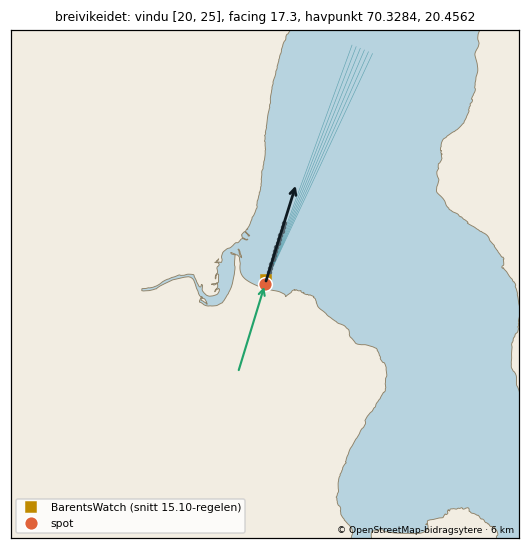

# Gjennomgangspakke: Troms (10 spots)

Laget 2026-11-12 av tools/region_pakke.py fra spots.json (gjelder der spoten ligger inne) og fabrikkens forslag (data/kandidater/bygget/<id>.json). 8 publisert, 2 venter på lokalkunnskap.

Vindu: fri linje 150 km over GSHHS f (300 m kysttoleranse). Facing: strandnormal ±150 m langs kysten. Offshore-vind: motsatt av facing ±45° når ikke annet står. BarentsWatch-punkt: snittregelen 15.10 (første punkt utover med minst 8 m dyp og flat Hs). Tidevann: Kartverkets referansested for posisjonen. Vern: Naturbase innen 2 km, målt fra spotens posisjon der oppslaget finnes (ellers fra listepinnen, og da står det), forskriften lest på Lovdata. Sikkerhet: A = navn, strandtype, synlig bølge/formasjon og retning stemmer; B = to av fire; C = resten (bygges ikke).

## Posisjonsrunden og gjennomgangen 10.11.2026

Hele svaret fra spotansvarlig ligger i `troms-gjennomgang.csv` (én linje per spot): **6 godkjent, 1 rett, 2 avvis.** Ingenting i spots.json eller appen er endret.

- **Godkjent (6):** de seks som alt er live (ersfjordstranda, grotfjord, lenangsoyra, russelv, steinkrossa, tromvik). Ingen endring i dem.
- **Rett (1):** bovaer. Posisjonen er godkjent (sikkerhet B) og spoten er bygget med spotfabrikken. BarentsWatch-punktet er rettet, se under.
- **Avvis (2):** laukvika-senja og hamn-senja venter på lokalkunnskap og er ikke bygget.

## bovaer: BarentsWatch-punktet

Snittet ble hentet 10.11 kl. 11:35Z (0 til 3 km langs facing, 18 tidspunkter, hver 3. time fra 10.11 kl. 06Z til 12.11 kl. 09Z, `data/bw_point_search/result_2026-11-10T1135_kandidater.json`).

| Avstand ut | EMODnet-dybde | Hs (median) | Retning |
|---|---|---|---|
| 100–700 m | 4,0–8,5 m | 0,60–0,67 m | 285–326° |
| 800–900 m | 0 m (skjær) | ingen data | – |
| 1 000–1 400 m | 4,3–6,3 m | 0,78–1,05 m | 309–328° |
| 1 500 m | 12,9 m | 0,79 m | 315° |
| 3 000 m | ikke hentet | 1,44 m | 339° |

- Punktvelgeren tok 1 500 m. Spotansvarlig rettet til **400 m ut (8,5 m)**, fordi stranda ligger i le av skjæret ved 800–900 m. Ved 1 500 m er Hs 1,3–1,5 ganger høyere enn ved 400 m (1,6–2,3 ganger ved 1 000–1 400 m), og vinduet (GSHHS) ser ikke skjæret, så ingenting i modellen ville trukket ned for det.
- **Lavere sikkerhet:** 400 m ligger i en lomme i EMODnet (5,3 m innenfor, 7,7 m utenfor) og oppfyller regelen fra 15.10 i 2 av 9 tidspunkter med svell i vinduet (1 500 m i 4). Punktet er retningsavhengig: Hs ved 400 og 600 m er like (under 10 % forskjell) bare når Hs ved punktet er minst ca. 0,5 m, det vil si i 3 av de 9 tidspunktene. Når svellet dreier mot nordvest (fra 11.11 kl. 12Z) faller Hs ved 400 m til 0,06–0,42 m, retningen går til 321–340° (31–50° fra facing), og 600 m har 1,6–3 ganger mer.
- Høydene [0,8, 2,0] og maks 3,5 er fabrikkens standard for strand, ukalibrert. Offshore-vinden er standard (motsatt av facing ±45°), ubekreftet.

## Breivikeidet 12.11.2026 (egen liten PR, Theodors ja til å bygge den)

Ny spot fra Theodor (ikke i lista 15.10): Sandbukta ved Breivikeidet, Tromsø kommune, innerst i Ullsfjorden. Theodor har bare hørt at den er bra og har ikke surfet der. Kilden er ikke navngitt, så spoten er **ubekreftet** (feltet `_ubekreftet` i spots.json) og ligger inne som `forelopig`. Spotansvarligs svar står i `troms-gjennomgang.csv` (rett: BarentsWatch-punktet).

- **Posisjon:** 69.659992, 19.664974. Det er 235 m fra Theodors pinne, midt på den NNØ-vendte delen av en ca. 1,1 km lang sand- og grusstrand, 100 m fra OSM-kystlinja. Ingen bølger er synlige i flyfotoet. Sikkerhet B.
- **Facing og vindu:** facing 17,3° (OSM 13–28°, flyfoto 14–18°). Vinduet er 20–25° (6°), det eneste med fri linje til åpent hav gjennom gapet mellom Vanna og Arnøya. 10–19° treffer Reinøya/Vanna 31–51 km ut, og 26–29° treffer Arnøya 55–64 km ut.
- **Offshorevind:** [152, 242], standard og ubekreftet.
- **Vern:** Sandbukta naturreservat dekker stranda og sjøen innerst i bukta. Forskriften har ikke ferdsels- eller surfeforbud, bare forbud mot motorferdsel på land.

### BarentsWatch-snittet

Snittet ble hentet 12.11 kl. 18:27Z (19 tidspunkter, hver 3. time fra 12.11 kl. 12Z til 14.11 kl. 18Z, `data/bw_point_search/result_2026-11-12T1827_kandidater.json`). BarentsWatch har data helt inn i bukta.

| Avstand ut | EMODnet-dybde | Hs (median, min–maks) | Retning (median) |
|---|---|---|---|
| 0 m | 2,0 m | 0,14 m (0,07–0,22) | 81° |
| 100 m | 8,8 m | 0,19 m (0,09–0,28) | 88° |
| 300 m | 30,8 m | 0,24 m (0,13–0,30) | 95° |
| 800–1 500 m | 55–79 m | 0,29–0,30 m (0,19–0,35) | 103–104° |

- Svellet ute var 0,8–1,4 m fra 11–27°, men BarentsWatch viste kort krappsjø fra øst (Tp 2–3 s) i 17 av 19 timer.
- I de to roligste timene (12.11 kl. 18Z og 13.11 kl. 00Z) var det 0,09 m fra 9° med Tp 7,5 s ved 100 m. Det er ca. 7 % av svellet ute, som da kom fra 12–18°, altså like utenfor vinduet.
- Regelen fra 15.10 fant derfor ikke noe punkt. Velgeren prøver bare timer der svellet ute kommer fra innenfor vinduet (20–25°), og det gjaldt 12 av 19 timer. I alle de 12 var retningen ved 100 m 69–88°, altså 46–66° fra svellet ute. De to svelltimene (svell ute fra 12–18°) ble ikke prøvd.
- Punktet ble satt til første punkt med minst 8 m dyp og data: **100 m ut (8,8 m)**, med lavere sikkerhet. Hs øker utover til ca. 800 m. Det er le bak Breivikneset for østlig krappsjø, ikke en brytesone (8,8 m er dypt vann for 3 s-bølger).

### Spørsmål til Theodor

1. **Havpunkt og langtidsdager:** fabrikkens havpunkt (70.3284, 20.4562) ligger 1,0 km fra Lenangsøyras, i den samme landmaskerte GFS-cellen, og spoten har ingen `offshore_longrange`. Anbefaling: bruk Lenangsøyras havpunkt og `offshore_longrange` 70.5/20.5. Det gir samme svelldata og ingen nye kall.
2. **Vinduet er 6°, ikke 15–30°:** nye spots har ingen geometrisk grunnlinje (`data/exposure_baseline.json`), så reserven bruker vindu og skyggekurve. Hvis grunnlinjen lages senere, gir den 0,38–0,48 over 10–30°, fordi øyene regnes som smale. Anbefaling: godta 20–25° som foreløpig uten `exposure_override`. Første observasjon og BarentsWatch blir fasiten.
3. **Vindsjø i fjorden:** med vind fra NNØ er det 31–65 km fetch, og det gir trolig 1–1,5 m med ca. 5 s, onshore. BarentsWatch tar med lokal vindsjø, men surfehøyden bruker GFS-perioden. Anbefaling: lag et forslag med før/etter som merker timer med kort periode hos BarentsWatch som vindsjø. Ingen endring nå.
4. **Hopp ved overgangen til reservesonen (dag 4 til ca. 8):** reserven regner transfer 0,6 × eksponering 0,67–0,85, det vil si 0,40–0,51 av svellet ute. BarentsWatch viste høyst ca. 15 % (svell i vinduet) og 7 % (svell fra 12–18°). Uten vind gir svell ute 1,0 m fra 25° (9 s) 1 stjerne, 1,4 m fra 21° (12 s) 2 stjerner og 2,0 m fra 22° (12 s) 3 stjerner. Med BarentsWatch er det 0 stjerner. Valg: (i) `exposure_override`-tak på ca. 0,2–0,25, (ii) egen transfer 0,15–0,2, eller (iii) la kalibreringen lære. Ulempen med (iii) er at parene blir krappsjø fra øst. Anbefaling: (i) som foreløpig tak til det finnes en observasjon. Grunnlaget er bare én kjøring på 19 timer.

## Hva som skal til

| Spot | Hva som mangler | Hvem |
|---|---|---|
| bovaer | Theodors ja til regionen. Da settes spoten inn i spots.json (`tools/godkjenn_spot.py`), og det kjøres én prøvehenting før merge. | Theodor |
| laukvika-senja | Ligger 635 m fra bovaer mot samme hav og ville fått nesten de samme tallene. Noen må bekrefte at det er en egen bølge, ellers avvises den som duplikat. | Lokalkunnskap |
| hamn-senja | Listepinnen står i havna mellom holmene, med bare smale åpninger mot vest. Trolig feil sted. Bergsøyan landskapsvernområde med dyrelivsfredning ligger 629 m unna (ferdselsforbudet på land 15.4–31.7 gjelder bare enkelte øyer). | Lokalkunnskap |

## Sett i de som alt er live (ingen endring i denne PR-en)

- **ersfjordstranda:** OSM-normalen er 287–295°, altså 20–28° fra facing 315°. Kjent fra før, og hører sammen med vindusspørsmålet som står i ROADMAP.
- **russelv:** vinduet er 8° + 11°, og facing 315° ligger 34° utenfor. En ny spot med dette vinduet ville blitt parkert.
- **lenangsoyra:** vinduet er 8°, men spoten har observasjon og Theodors overstyring.
- **steinkrossa:** facing 45° er strandnormalen, og vinduet (315–16°) ligger 29° utenfor.
- BarentsWatch-punktene til alle seks ligger ca. 250 m ut med ukjent dybde. Alle har skyggepunkt.

## Ikke sjekket

- Flyfotoene er ikke sett på nytt etter posisjonsrunden. Gjennomgangen bygger på minikart, OSM-kyst og snittet.
- EMODnet og BarentsWatch bruker ikke samme bunn, så 8 m-kravet er testet mot en annen bunn enn Hs-profilen. Det gjelder særlig lomma ved 400 m.
- Naboene (steinkrossa, ersfjordstranda) er sammenlignet bare mot arkivet fra 10.11 kl. 06Z.

## Oversikt

| id | Navn | Region | Status | Sikkerhet | facing | Vindu | Offshore-vind | BarentsWatch-punkt |
|---|---|---|---|---|---|---|---|---|
| bovaer | Bøvær | Troms | publisert | B | 289.8° | 251–326° | 65–155° | 69.469189, 17.217652 (400 m ut i retning 290°, 8.5 m dyp) |
| breivikeidet | Breivikeidet | Troms | publisert | B | 17.3° | 20–25° | 152–242° | 69.660855, 19.665743 (100 m ut i retning 17°, 8.8 m dyp) |
| ersfjordstranda | Ersfjordstranda | Troms | publisert | ikke sjekket | 315° | 294–320° | 90–180° | 69.485517, 17.394874 (251 m ut i retning 315°, dybde ukjent) |
| grotfjord | Grøtfjord | Troms | publisert | ikke sjekket | 295° | 286–310° | 76–166° | 69.779773, 18.529373 (250 m ut i retning 295°, dybde ukjent) |
| hamn-senja | Hamn (Senja) | Troms | venter på lokalkunnskap | C (forslag, ikke godkjent) | – | – | – | – |
| laukvika-senja | Laukvika (Senja) | Troms | venter på lokalkunnskap | C (forslag, ikke godkjent) | – | – | – | – |
| lenangsoyra | Lenangsøyra | Troms | publisert | ikke sjekket | 19° | 15–23° | 155–245° | 69.849744, 19.989858 (251 m ut i retning 360°, dybde ukjent) |
| russelv | Russelv | Troms | publisert | ikke sjekket | 315° | 5–15° + 349–356° | 90–180° | 69.949979, 20.215157 (251 m ut i retning 315°, dybde ukjent) |
| steinkrossa | Steinkrøssa | Troms | publisert | ikke sjekket | 45° | 315–16° | 175–265° | 69.493305, 17.263036 (251 m ut i retning 45°, dybde ukjent) |
| tromvik | Tromvik | Troms | publisert | ikke sjekket | 330° | 314–349° | 105–195° | 69.779615, 18.431276 (251 m ut i retning 330°, dybde ukjent) |

## Holdes tilbake, parkert eller ikke bygget

| id | Status | Hvorfor |
|---|---|---|
| hamn-senja | venter på lokalkunnskap | Listepinnen sto på anlegget Hamn i Senja, i havna mellom holmene. Regnet med skjær (OSM) er det bare smale åpninger mot vest (274-279° og 290-299°, ingen sektor over 10°), og kystnormalen ved den lille stranda peker mot sør, inn i havna. Dokumentasjonen er svak (to kilder) og stedet trolig feil; uten lokalkunnskap om et annet sted bør kandidaten avvises. |
| laukvika-senja | venter på lokalkunnskap | Ei sandlomme på ca. 40 m bare 635 m nord for Bøstranda, mot samme åpne hav (GSHHS 250-304° mot 251-326° for bovaer), så den vil få nesten de samme tallene som bovaer. Kildene er bade- og turistsider uten bruddtype. Trenger noen som vet om det finnes en egen bølge her; hvis ikke, bør den avvises som duplikat av bovaer. |

## Kallbudsjett

| | Spots | Open-Meteo vektet per kjøring | per døgn (grense 10 000) | verste time (5 000) | verste minutt (600) | BarentsWatch per kjøring / døgn | met.no per kjøring | Kartverket per kjøring |
|---|---|---|---|---|---|---|---|---|
| i dag (publiserte) | 27 | 95 | 759 (8%) | 95 (2%) | 95 (16%) | 44 / 352 | 81 | 27 |
| med alle 0 ventende i regionen slått på | 27 | 95 | 759 (8%) | 95 (2%) | 95 (16%) | 44 / 352 | 81 | 27 |

Open-Meteo: vekt 1,14 per punkt (16 dager), to bølgemodeller per havpunkt og ett vindpunkt per spot, 8 kjøringer per døgn; verste minutt regner alle kall i en kjøring i samme minutt. Testen fetcher/test_kallregnskap.py holder hver grense under 50 %.

## Spotene

### Bøvær (`bovaer`) - publisert

| | |
|---|---|
| Posisjon | 69.467964, 17.227291 - godkjent forslag (flyfoto), spotansvarlig (agent, Theodor 10.11.2026), 2026-11-10. 120 m fra listepinnen. Bøstranda, ca. 500 m sandstrand som vender VNV med sandbunn. Listepinnen sto på land; satt ca. 100 m utenfor vannkanten midt på stranda. Små skjær ligger ca. 110 m lenger ut. Hovedtoppen er ukjent. |
| Facing | 289.8° |
| Svellvindu | 251–326° |
| Offshore-vind | 65–155° |
| Havpunkt | 69.5024, 16.9358 (12 km ut i retning 289°) |
| BarentsWatch-punkt | 69.469189, 17.217652 (400 m ut i retning 290°, 8.5 m dyp) Flyttet til 400 m ut i snittet langs 289.8° (dybde 8.5 m) - spotansvarlig 10.11.2026: stranda ligger i le av skjæret 800-900 m ut, og regelen fra 15.10 valgte 1500 m utenfor skjæret; lavere sikkerhet. Snitt langs facing (data/bw_point_search/result_2026-11-10T1135_kandidater.json), første punkt med dybde ≥ 8 m og BarentsWatch-data (retting fra gjennomgangen): snitt 400m@289.8, 400 m ut, dybde 8,5 m. |
| Eksponering | vindu 75° bredt, facing 1° fra midten; ingen geometrisk grunnlinje ennå - henteren bruker vindu og skyggekurve som reserve |
| Tidevannssted | Andenes, faktor 1.01 |
| Høyder | ideal [0.8, 2.0], maks 3.5 |
| Vern/forbud | ingen verneområder innen 2 km av spoten |
| Sikkerhet | B |
| Usikkert | offshore-vind: standard, ubekreftet (motsatt av facing ±45°) barentswatch_point rettet: 400 m ut (spotansvarlig 10.11.2026: stranda ligger i le av skjæret 800-900 m ut, og regelen fra 15.10 valgte 1500 m utenfor skjæret; lavere sikkerhet) |

### Breivikeidet (`breivikeidet`) - publisert

| | |
|---|---|
| Posisjon | 69.659992, 19.664974 - godkjent forslag (flyfoto), spotansvarlig (agent, Theodor 10.11.2026), 2026-11-12. 235 m fra listepinnen. Sandbukta: ca. 1,1 km sand-/grusstrand innerst i bukta på vestsida av Ullsfjorden (Breivikelva-deltaet bak). Den rette delen av stranda vender mot NNØ (OSM-kystnormal 13-28°). Satt midt på den delen, ca. 100 m ut fra OSM-kystlinja (ca. 70 m fra vannkanten i flyfotoet). Ingen bølger synlige i flyfotoet; hovedtoppen er ukjent. Pinnen sto ca. 260 m ut i bukta. |
| Facing | 17.3° |
| Svellvindu | 20–25° |
| Offshore-vind | 152–242° |
| Havpunkt | 70.3284, 20.4562 (80 km ut i retning 22°) |
| BarentsWatch-punkt | 69.660855, 19.665743 (100 m ut i retning 17°, 8.8 m dyp) Snitt langs facing (data/bw_point_search/result_2026-11-12T1827_kandidater.json), første punkt med dybde ≥ 8 m og BarentsWatch-data (retting fra gjennomgangen): snitt 100m@17.3, 100 m ut, dybde 8,8 m. Lavere sikkerhet (spotansvarlig 12.11.2026): 15.10-regelen fant ikke noe punkt: velgeren prøver bare timer med svell ute fra innenfor vinduet (12 av 19), og i alle de 12 var retningen ved 100 m 69-88° (46-66° fra svellet ute). BarentsWatch viste kort krapp sjø fra øst i 17 av 19 timer (100 m: 0,12-0,28 m, Tp 2,0-2,9 s) mens svellet ute var 0,8-1,4 m fra 11-27°. I de to roligste timene (12.11 kl. 18Z og 13.11 kl. 00Z) sto det igjen 0,09 m fra 9° med Tp 7,5 s ved 100 m - ca. 7 % av svellet ute (1,2-1,26 m fra 12-18°, like utenfor vinduet). Hs øker fra 0,19 m (100 m) til 0,30 m (800 m) og flater ut der; økningen er le bak Breivikneset for østlig krappsjø, ikke brytesone (8,8 m er dypt vann for 3 s bølger). 100 m er derfor beholdt som punktet som best ligner stranda. |
| Eksponering | vindu 5° bredt, facing 5° fra midten; ingen geometrisk grunnlinje ennå - henteren bruker vindu og skyggekurve som reserve |
| Tidevannssted | Hammerfest (-50 min), faktor 1.02 |
| Høyder | ideal [0.8, 2.0], maks 3.5 |
| Vern/forbud | Sandbukta naturreservat, listepinnen ligger inne i området: bare motorferdsel på land forbudt; både Theodors pinne og posisjonen ligger inne i reservatet (sjøarealet innerst i Sandbukta er med). Lagt inn for hånd 12.11.2026 (Naturbase-oppslag fra posisjonen, ikke fra tools/kandidat_vern.py). |
| Sikkerhet | B |
| Usikkert | facing 17.3° ligger 3° utenfor eget svellvindu (20–25°) offshore-vind: standard, ubekreftet (motsatt av facing ±45°) barentswatch_point rettet: første punkt med dybde ≥ 8 m og BarentsWatch-data (100 m ut), regelen fant ingen punkt; lavere sikkerhet (spotansvarlig 12.11.2026) |

### Ersfjordstranda (`ersfjordstranda`) - publisert

| | |
|---|---|
| Posisjon | 69.483919, 17.399405 - spots.json (satt før kandidatlista) |
| Facing | 315° |
| Svellvindu | 294–320° |
| Offshore-vind | 90–180° |
| Havpunkt | 69.5764, 17.0514 (17 km ut i retning 307°) |
| BarentsWatch-punkt | 69.485517, 17.394874 (251 m ut i retning 315°, dybde ukjent) |
| Eksponering | vindu 26° bredt, facing 8° fra midten; geometrisk grunnlinje finnes (data/exposure_baseline.json) |
| Tidevannssted | slås opp av henteren (Kartverket) |
| Høyder | ideal [0.8, 2.0], maks 3.5 |
| Vern/forbud | ingen verneområder innen 2 km av listepinnen |
| Sikkerhet | ikke sjekket |
| Usikkert | – |

### Grøtfjord (`grotfjord`) - publisert

| | |
|---|---|
| Posisjon | 69.778818, 18.535261 - spots.json (satt før kandidatlista) |
| Facing | 295° |
| Svellvindu | 286–310° |
| Offshore-vind | 76–166° |
| Havpunkt | 69.866, 18.1098 (19 km ut i retning 301°) |
| BarentsWatch-punkt | 69.779773, 18.529373 (250 m ut i retning 295°, dybde ukjent) |
| Eksponering | exposure_override [{'from': 311, 'to': 330, 'max': 0.2}, {'from': 276, 'to': 285, 'max': 0.2}]; vindu 24° bredt, facing 3° fra midten; geometrisk grunnlinje finnes (data/exposure_baseline.json) |
| Tidevannssted | slås opp av henteren (Kartverket) |
| Høyder | ideal [0.8, 2.0], maks 3.5 |
| Vern/forbud | ingen verneområder innen 2 km av listepinnen |
| Sikkerhet | ikke sjekket |
| Usikkert | – |

### Hamn (Senja) (`hamn-senja`) - venter på lokalkunnskap

| | |
|---|---|
| Posisjon | 69.4172, 17.1641 - listepinnen (ikke kontrollert) |
| Forslag | 69.416517, 17.163551 (claude-flyfoto-2026-11-10, sikkerhet C, ikke godkjent; flyttet 79 m fra listepinnen). Listepinnen står på anlegget Hamn i Senja, i havna mellom holmene. Området ligger i le bak skjær og grunne sandflater (Bergsøyan) mot nord og nordøst og er bare åpent mot vest. Fant ingen tydelig surfestrand. Posisjonen er beste gjetning, i vannet utenfor den lille stranda ved anlegget. Trolig feil sted; trenger lokalkunnskap. |
| Sikkerhet | C (forslag, ikke godkjent) |
| Vern/forbud | Bergsøyan landskapsvernområde med dyrelivsfredning, 630 m fra forslaget (listepinnen: 554 m): ferdselsforbud (land, § 3 nr. 3) |
| Usikkert | Listepinnen sto på anlegget Hamn i Senja, i havna mellom holmene. Regnet med skjær (OSM) er det bare smale åpninger mot vest (274-279° og 290-299°, ingen sektor over 10°), og kystnormalen ved den lille stranda peker mot sør, inn i havna. Dokumentasjonen er svak (to kilder) og stedet trolig feil; uten lokalkunnskap om et annet sted bør kandidaten avvises. |

### Laukvika (Senja) (`laukvika-senja`) - venter på lokalkunnskap

| | |
|---|---|
| Posisjon | 69.4745, 17.2249 - listepinnen (ikke kontrollert) |
| Forslag | 69.473596, 17.224552 (claude-flyfoto-2026-11-10, sikkerhet C, ikke godkjent; flyttet 101 m fra listepinnen). Listepinnen sto ved bergnabben ved siden av ei lita sandlomme (ca. 40 m bred) nord i bukta. Satt ca. 75 m ut sørvest for lomma, over sandbunn. Kildene er bade- og turistsider, bruddtypen er ukjent, og bukta ligger bare ca. 600 m nord for Bøstranda (bovaer). Usikkert om dette er en egen surfespot. |
| Sikkerhet | C (forslag, ikke godkjent) |
| Vern/forbud | ingen verneområder innen 2 km av forslaget |
| Usikkert | Ei sandlomme på ca. 40 m bare 635 m nord for Bøstranda, mot samme åpne hav (GSHHS 250-304° mot 251-326° for bovaer), så den vil få nesten de samme tallene som bovaer. Kildene er bade- og turistsider uten bruddtype. Trenger noen som vet om det finnes en egen bølge her; hvis ikke, bør den avvises som duplikat av bovaer. |

### Lenangsøyra (`lenangsoyra`) - publisert

| | |
|---|---|
| Posisjon | 69.847483, 19.989858 - spots.json (satt før kandidatlista) |
| Facing | 19° |
| Svellvindu | 15–23° |
| Offshore-vind | 155–245° |
| Havpunkt | 70.3349, 20.4737 (57 km ut i retning 18°) |
| BarentsWatch-punkt | 69.849744, 19.989858 (251 m ut i retning 360°, dybde ukjent) |
| Eksponering | exposure_override [{'from': 225, 'to': 320, 'max': 0.05}]; vindu 8° bredt, facing 0° fra midten; geometrisk grunnlinje finnes (data/exposure_baseline.json) |
| Tidevannssted | slås opp av henteren (Kartverket) |
| Høyder | ideal [0.8, 2.0], maks 3.5 |
| Vern/forbud | ingen verneområder innen 2 km av listepinnen |
| Sikkerhet | ikke sjekket |
| Usikkert | – |

### Russelv (`russelv`) - publisert

| | |
|---|---|
| Posisjon | 69.94838, 20.219789 - spots.json (satt før kandidatlista) |
| Facing | 315° |
| Svellvindu | 5–15° + 349–356° |
| Offshore-vind | 90–180° |
| Havpunkt | 70.3581, 20.4291 (46 km ut i retning 10°) |
| BarentsWatch-punkt | 69.949979, 20.215157 (251 m ut i retning 315°, dybde ukjent) |
| Eksponering | vindu 17° bredt, facing 55° fra midten; geometrisk grunnlinje finnes (data/exposure_baseline.json) |
| Tidevannssted | slås opp av henteren (Kartverket) |
| Høyder | ideal [0.8, 2.0], maks 3.5 |
| Vern/forbud | Lyngsalpan landskapsvernområde/Ittugáissáid Suodjemeahcci, 1366 m fra listepinnen: forskriften ikke lest |
| Sikkerhet | ikke sjekket |
| Usikkert | facing 315° ligger 34° utenfor eget svellvindu (5–15° + 349–356°) |

### Steinkrøssa (`steinkrossa`) - publisert

| | |
|---|---|
| Posisjon | 69.491707, 17.258504 - spots.json (satt før kandidatlista) |
| Facing | 45° |
| Svellvindu | 315–16° |
| Offshore-vind | 175–265° |
| Havpunkt | 69.6125, 17.1506 (14 km ut i retning 343°) |
| BarentsWatch-punkt | 69.493305, 17.263036 (251 m ut i retning 45°, dybde ukjent) |
| Eksponering | vindu 61° bredt, facing 60° fra midten; geometrisk grunnlinje finnes (data/exposure_baseline.json) |
| Tidevannssted | slås opp av henteren (Kartverket) |
| Høyder | ideal [0.8, 2.0], maks 3.5 |
| Vern/forbud | ingen verneområder innen 2 km av listepinnen |
| Sikkerhet | ikke sjekket |
| Usikkert | facing 45° ligger 29° utenfor eget svellvindu (315–16°) |

### Tromvik (`tromvik`) - publisert

| | |
|---|---|
| Posisjon | 69.777657, 18.434525 - spots.json (satt før kandidatlista) |
| Facing | 330° |
| Svellvindu | 314–349° |
| Offshore-vind | 105–195° |
| Havpunkt | 69.9048, 18.2361 (16 km ut i retning 332°) |
| BarentsWatch-punkt | 69.779615, 18.431276 (251 m ut i retning 330°, dybde ukjent) |
| Eksponering | vindu 35° bredt, facing 2° fra midten; geometrisk grunnlinje finnes (data/exposure_baseline.json) |
| Tidevannssted | slås opp av henteren (Kartverket) |
| Høyder | ideal [0.8, 2.0], maks 3.5 |
| Vern/forbud | ingen verneområder innen 2 km av listepinnen |
| Sikkerhet | ikke sjekket |
| Usikkert | – |

Kyst © OpenStreetMap-bidragsytere og GSHHS; dybde EMODnet Bathymetry; tidevann © Kartverket; bølger BarentsWatch; vern Naturbase (Miljødirektoratet).
